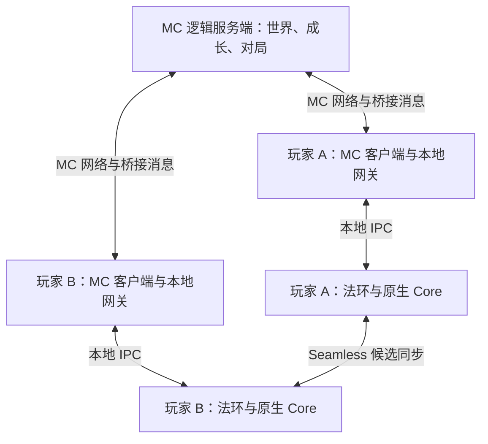

# Minecraft-Ring 架构决策 v0.1

2026-10-13 · 面向持续开发的目标架构。代码核对基线：`e2188391b5ba1257a9853920244909decf3bd97f`。本次没有重构代码、创建新仓库或新增运行验证；下文的接口和制品拆分为后续实现约束。

入口：[持续开发路线](gameplay-roadmap.md) · [技能树与成组验收](reviews/20261013-skill-tree-batched-validation.md) · [联机研究](reviews/20261013-mc-abilities-multiplayer.md)。历史 review 保留其原始证据；新的优先级以路线图为准。

## 1. 仓库与版本决策

项目自己的原生 Core、角色 Bridge、MC 世界、玩法、适配器、数据及工具继续放在 **`0smium/Minecraft-Ring` 一个主仓库**。先建立代码依赖边界，再按实际需要拆同仓构建模块。当前 DLL、协议、MC 代码和启动配置共同变化，同仓可以在一个提交中保留配套版本。

LB 是外部上游：若统一能力入口或 GUI 需要修改其源码，单独 fork LiquidBounce，保留上游历史；主仓只维护适配器、公共能力协议和固定制品依赖。最终可以是“一个产品主仓库 + 一个 LB 上游 fork”，不把完整 LB 源码复制进 Bridge，也不为每个玩法再建仓库。Meteor 首先通过主仓内可选适配器/add-on 接入；只有实际需要改其源码才评估 fork。本轮不创建这些 fork。

| 对象 | 现在放在哪里 | 独立的条件 |
| --- | --- | --- |
| 原生 Core 与本地 IPC | 现有 `bridge-base/elden-ring/er-bridge` | 暂不拆；和桥接协议一起维护 |
| 角色 Bridge、世界和玩法 | 现有 `bridge-base/elden-ring/mc-bridge` 内分包，随后按需要拆 Gradle 子项目 | 同仓独立制品即可满足多数需求 |
| LB/Meteor 适配 | 主仓的可选客户端集成模块 | 外部客户端源码定制使用各自上游 fork |
| 地图配置、技能树、配方、遭遇模板、模式 | 主仓中可版本化的数据目录；具体目录随第一份内容建立 | 出现独立内容维护/发布需求后再考虑内容仓 |
| 测试后端、启动配置、版本清单、诊断 | 主仓 | 与每批产品版本共同发布 |
| 大厅/账号/匹配/战绩服务 | 远期独立平台候选，当前不建空项目 | 真正出现独立部署与运维需求时再拆 |

Bridge 拆仓需同时满足：公共 API 不再依赖 Core 私有类/地址；能独立构建并用测试后端开发；有配套版本检查与至少两批实际升级记录；出现其他项目使用或独立维护者/发布节奏。只因功能变多、文件变多或想开新 session，不构成拆仓理由。

当前主线继续使用 MC 1.21.1/Fabric 和已固定的 LB 版本。26.3 保留为有限迁移实验：先说明必须获得的具体收益，再用同一验收集比较。没有验证合成、输入、实体、成长、存档及服务端之前，不替换主线；不因为旧插件生态而回退 1.8。已有版本调研不在本文重复，见[版本与联机研究](reviews/20261013-mc-abilities-multiplayer.md)。

## 2. 组件边界与依赖

下面是职责划分，不要求立即建立七个空模块或七个 JAR。现有 `settings.gradle` 只有一个根工程，`build.gradle` 已启用 `splitEnvironmentSourceSets()`；可以先按现有 `main`/`client` 源集落地，再在独立编译/发布有收益时拆子项目。

| 组件 | 职责 | 允许依赖 | 不应持有的职责 |
| --- | --- | --- | --- |
| ER Runtime | 版本/地址适配、游戏线程读写、原生动作、角色/敌人状态、渲染与原生碰撞 | 现有 native 协议、宿主能力实现 | LB 类、技能树成本、UHC 胜负 |
| Bridge API | 能力描述、角色/场景/实体身份、快照、请求、确认、失败类型 | 小型公共数据类型 | 客户端单例、native 地址、具体作弊端类 |
| MC Core / 本地网关 | 合成、输入/焦点、IPC、坐标转换、实体代理、世界连接；将有身份的宿主消息转发给逻辑服 | Bridge API、MC/Fabric；本地宿主实现仅在客户端 | 点数来源、战利品表、模式胜负 |
| Character Bridge | 背包/装备/属性、施法/战技/祷告/弹反、制作、MC 马与隐藏施法者协调；UI 与请求处理 | Bridge API、MC Core 的公开服务 | 另一份可自行消费的 ER 库存、LB 私有实现 |
| World / Gameplay | 固定地图与可变方块、资源、技能点、能力策略、遭遇、缩圈、结算和存档 | Bridge API、MC 服务端 API；通过接口请求角色能力 | 直接访问共享内存、游戏窗口或 LB/Meteor |
| Client integrations | LB/Meteor 选敌/HUD、输入、模块授权、GUI/config 适配 | Bridge 公共能力/实体视图、对应客户端 API | 自行发点、决定敌人死亡或奖励、读 ER 裸地址 |
| Content / Dev tools | 树定义、配方、模板、预设；测试后端、诊断、批量场景 | 已公开的数据格式和 API | 绕过正式接口实施另一套生产逻辑 |

依赖方向由玩法/适配器指向公共 API。底座不反向依赖玩法，Gameplay 不依赖 LB，LB 与 Meteor 互不依赖。Character Bridge 的背包、坐骑和施法在没有 LB/Meteor 的 Core profile 中也应可用；换能力客户端不应损坏存档。

宿主接口只抽出本项目现在需要的能力，不预先造兼容所有游戏的通用引擎。未来 HK/P5R 可复用点数、模式、请求与结果处理等概念；原生游戏适配仍各自实现。

## 3. 部署与联机目标

单人时逻辑服务端仍在 MC 集成服务器内；专用服使用相同玩法语义。图中的双 ER 共载尚未验证，不代表现成可用。当前 `ErLink` 是进程单例，服务端逻辑直接消费本地宿主状态；迁移时增加按玩家注册的 `HostBackend` 边界，让逻辑服消费事件和请求结果，本地内存读取移到玩家网关。模拟后端走相同接口。

| 运行配置 | 需要的内容 | 验收目标 |
| --- | --- | --- |
| MC standalone | MC 世界/玩法与所需内容依赖；native 能力明确不可用 | 不启动 ER 仍能加载已导出的可见地图、资源和 MC 规则 |
| 联动单人 Core | MC + Bridge + 本地 ER/Core；无需能力客户端 | 背包、坐骑、动作、实体与世界桥接 |
| 联动单人 LB / Meteor | Core 加一种已验证客户端及其适配器 | 使用相同成长规则；配置与 run 目录分别隔离 |
| MC 专用服 | 公共注册项、世界/玩法、网络接收和服务端依赖 | 不加载 GUI/LB/本地共享内存，不要求服务器运行 ER |
| 双游戏多人 | 各玩家本地联动配置 + 同一 MC 服 + 已验证 ER 联机会话 | 各玩家身份匹配，共同坐标，一次伤害与结算 |

初期保留一套原生 DLL 和一个含 `main`/`client` 源集的 Bridge JAR 即可。随着专用服和可选客户端接入，优先把客户端集成拆成可选制品，随后按独立运行需要拆 Gameplay。逻辑模块数不等于用户要手动安装的 JAR 数，启动 profile 管配套依赖。

LB/Meteor 放客户端，不装到专用服。Pufferfish 等内容依赖按实际客户端/服务端要求配置。客户端和服务端含注册内容时保持相容的注册表；不能凭一个模组的 `environment: *` 就宣布专用服通过。

## 4. 数据归属与唯一裁决

| 数据/行为 | 权威来源 | 桥接规则 |
| --- | --- | --- |
| MC 方块、矿石、马、生物、普通库存 | MC 逻辑服务端/世界存档 | 客户端发意图，服务端确认；马的运动走 MC |
| 技能点、节点、能力上限、模式时钟、胜负 | MC 逻辑服务端 | LB/Meteor 只是显示和执行；竞技额度不能盲信客户端 ER 等级 |
| ER 背包、原生装备、法术资源、动作结果 | 对应角色的 ER 宿主 | UI 是视图；请求有确认，原生合法执行后重读核对 |
| 玩家最终 HP/淘汰 | MC 规则层 | ER 受击转为一次事件；原生角色保护/复活不得覆盖模式裁决 |
| ER 敌人 AI、HP、死亡/阶段 | ER 联机会话中的对应权威来源 | MC 代理不运行第二套扣血/死亡；跨客户端实体归属需验证 |
| 静态地图模板、坐标变换 | 固定版本地图包 | 所有参与者使用相同区域身份与变换 |
| 本局方块改动、遭遇进度、领奖记录 | MC 世界/对局存档 | 不被重采样覆盖；重开 MC 世界不等于复位 ER 剧情 |
| GUI 布局、按键、模块偏好值 | 对应客户端 profile | 与授权、生效值分开；更换客户端不迁移服务端账本 |

原生防御可能已经影响受击值，MC 护甲/附魔如何继续叠加必须在效果映射表中明确。每种属性记录来源、单位、作用侧和叠加公式；界面显示最终有效值，避免两边对同一效果重复计算。

隐藏角色是原生动作执行者，MC 是通常的移动/骑乘控制者。为施法前摇、释放、后摇、打断建立动作状态与冲突输入规则；是否允许移动由具体动作描述，带位移动作单独适配。不得让两套位置写入者在同一动作中争夺控制权。

## 5. 协议与能力接口的最低要求

本地共享内存 ABI 和多人网络协议分层维护：网络不发送原生指针或裸共享内存区，玩法也不依赖 native 字段偏移。沿现有扩展区增量增加能力/版本检查，不一次重写全部旧协议。

每个会修改状态的请求包含：协议/能力版本、玩家身份、宿主会话与角色绑定、场景世代、请求 ID、预期状态修订、参数。服务端从已认证连接确定玩家身份，不信任报文自行填写的 UUID；宿主/角色绑定需要验证。结果区分接受、执行中、已确认成功、明确失败、结果未知；超时后先查询和对账，不盲目重放扣款/生成。

关键接口按实际批次增加：

- `HostStatus`：版本、活跃角色/场景、连接、能力可用性和失败原因。
- `HostEntityView`：稳定的会话内实体身份、敌对性、名称、HP、AABB 与有效状态。
- `InventorySnapshot / InventoryCommand`：库存修订、物品身份、装备/使用请求及结果。
- `ActionRequest / ActionState`：动作 ID、目标、阶段、允许输入、消耗、冷却与打断。
- `CapabilitySnapshot`：玩家已学能力、允许模式、有效参数、策略修订。
- `EncounterEvent / RewardReceipt`：生成确认、明确死亡、阶段、回收归属和一次领奖记录。
- `WorldSnapshot / BlockDelta`：地图/区块修订、可修改范围、方块更新与原生碰撞确认。

按玩家/宿主/场景路由事件；重连时旧会话失效并获取完整快照，再接后续增量。数据包可重复或迟到，因此通过请求去重、确认、持久记录和恢复核对实现业务效果不重复；不声称跨两套存档天然具有原子事务。

多人网络额外限制报文大小、频率和可请求能力；仅转发经过定义的操作，不提供“远程读写任意 ER 地址”。第一版合作模式可接受约定客户端，但不能把 MC 反作弊描述成对另一进程全部状态的可信验证。

## 6. 世界生成与碰撞边界

地图由固定模板、原生动态对象、MC 可变层分别拥有范围。首版沿用 MC 存档加少量元数据，记录区域变换、生成器/配置版本、种子、采样覆盖和未知空间；先保证一个赛区可复现，再扩大范围。可见方块表示与碰撞缓存分开验收。

资源放在分配给 MC 的区域：树、食物、矿脉、洞穴、生物及制作链由 MC 管。每局复制模板并记录增量，矿物挖掉后不能被重采样补回。地下先提供已验证入口/独立 MC 区域，随后再做同坐标过渡；原生洞窟、桥下和多层建筑需要保留三维空腔。

MC 增加方块 → ER 物理碰撞，是独立的原生能力；拆方块时同步移除对应碰撞对象。角色、普通敌人、投射物分别验收。物理能挡住不等于 AI 已会绕路；任意原生地形删除又需要处理原生可见几何、碰撞、场景与导航，不能由“右键生成一个 MC 石头”自动获得。

世界组件只通过公开碰撞请求与状态接口调用 Runtime。由策略明确某区域当前支持哪些交互，UI 不宣传未实现的“可挖穿原生山体”或“Boss 会进新矿洞”。这些完整融合目标保留在路线图，不阻塞已有 MC 生存内容。

## 7. 配套发布与持续维护

每批记录一份发行清单：主仓提交、native 协议/制品、Bridge 版本、MC/Loader/依赖、LB fork 提交或固定上游制品、适配器、地图/数据包版本及摘要。配置使用角色自由模式、成长模式、UHC 和调试模式；调试权限不写入公开对局默认规则。

数据存档需要模式/格式版本和迁移策略。用复制的测试世界验证升级；正式升级先备份可恢复状态，再迁移。GUI/config 的偏好与技能账本独立，规则调整不直接覆盖用户全部配置。不要将多个同时运行的 profile 指向同一份可写世界目录。

仓库不提交游戏安装、用户存档、原始共享内存和大日志。测试后端使用合成/脱敏数据。外部模组按其实际发布方式取得，保留已有第三方说明；fork 的许可证与依赖声明不被主仓许可证覆盖。

边界验收包括：Core 无 LB 启动；逻辑服不加载客户端类；玩法使用模拟后端可运行；宿主断连显示能力不可用；换客户端保留相同成长；旧协议拒绝状态修改且给出原因。抽接口随功能一起交付，不设一个长期纯重构阶段。

## 8. 当前仍未解决的实现项

- `CombatBridge` 和 `LifeBridge` 仍广播一个宿主的受击/死亡，需按绑定改造；通用 HP/实体视图也未覆盖全部消费者。
- 真正角色背包、动作确认、MC 马、等级发点及能力策略仍是待开发范围，不因定义接口而完成。
- 固定可见 MC 地图、地下生存、MC→ER 方块碰撞、双 ER 共载均未在本轮验证。
- 外部 fork、Gradle 子项目拆分、独立 Gameplay 制品与发行清单都未在本轮创建。

以上工作的分批交付、前置条件和验证方式统一维护在[持续开发路线](gameplay-roadmap.md)。
