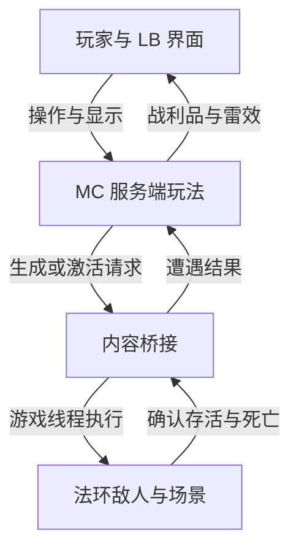

# Minecraft-Ring 持续开发路线 v0.3

2026-10-14 更新 · 长期功能批次与里程碑\
当前实现审查点：PR #6 / `3f7447096556f11db4bad6066198e6306e5f205f`\
配套：[当前状态与 PR 顺序](current-development.md) · [架构决策](architecture.md) · [review 索引](reviews/README.md)

用户要求扩大后续规划，并按功能组持续开发、集中验证。本文件统一长期批次、依赖和验收；当前实现与近期队列只在当前状态页维护。历史 review 保存各自基线；旧建议与当前架构冲突时按架构执行。所有 B01–B09 都是目标批次，不能因写入路线图就标为已实现。

架构决策：自有 Core、完整角色 Bridge、世界、玩法、适配器与工具继续在一个主仓库内；独立角色 Fabric 模组是近期必须交付的构建边界，不再仅按包隔离。LB 必须改源码时单独保留上游 fork。当前维持 MC 1.21.1；复用原版容器、效果、Horse 和实际客户端模块，通用策略统一管理解锁、参数与临时状态。详细边界见[架构文档](architecture.md)。

研究证据按主题查询：[地图与资源](reviews/20261012-map-worldgen-version.md)、[Core/Meteor 与内容组件](reviews/20261013-core-meteor-inventory.md)、[角色操作/成长/碰撞/Debug](reviews/20261013-actions-growth-world-debug.md)、[坐骑/施法/双游戏联机](reviews/20261013-mc-abilities-multiplayer.md)、[技能树/动态策略/单人联机验证](reviews/20261013-skill-tree-batched-validation.md)。

## 1. 与原计划的关系

保留 [LB 开发方案](lb-development-plan.md)、[LB 实验计划](lb-experiment-plan.md)及原验收事实，不把尚未通过的实验改写成通过。未收尾的真实 LB、GUI/视觉、Fly/Velocity 与 Core 可靠性工作作为 B01/B02 的相关子项推进，不再要求先穷尽全部旧问题才开始新功能。已有运行事实以 [2026-10-12 检查点](experiments/20261012-checkpoint.md)及逐轮记录为准。

用户当前确定：LB 是成品中的角色能力层；后续还需要法环物品/装备与 MC 的结合，以及有资源、成长和目标的玩法。原方案中的自研小模块保底即使有诊断价值，也不能替代“真实 LB 接入成功”的成果。

推进方式为边玩边测、记录缺口、先完成可玩的短流程。非阻塞问题可以作为场景限制保留，例如暂时选择不依赖升降平台的路线；不能因此宣称平台已修复或原关卡全部通过。会导致无法游玩、物品重复结算或持久状态损坏的问题，必须在依赖它的流程中先解决。不要把后来想到的全部玩法能力变成当前 LB 实验的新前置条件。

## 2. 产品目标：交界地中的 UHC 风格远征

玩家看到地图上的遭遇点与补给点，选择路线获取材料和装备；接近某个点后触发法环敌人/Boss/红灵 NPC 遭遇；MC 侧结算确认的击杀，播放雷效和公告，并在场景中掉落可拾取装备；区域随时间收缩，把玩家引向最终目标。LB 提供经过验证的移动、战斗辅助和视觉能力。

灵感来自用户描述的 Hypixel UHC 式发育和击杀反馈；这里定义自己的规则，不声称已复刻该服务器的规则或实现。

首个完整模式先做单人 PvE 远征。它验证 UHC 所需的资源、计时、区域和淘汰/结算系统；多人 PvP 和共享法环敌人的 PvPvE 在后续独立验证。自由建造与主线通关可复用同一套物品、装备和能力，不强制使用缩圈规则。

“红灵”首版指法环风格的敌对 NPC，不依赖真实玩家入侵。

## 3. 一个主仓库，按组件协作

以下工作线用于分配职责，同一批交付可以同时涉及三条线；它们不要求三个仓库，也不要求同时运行三个 agent。

| 工作线 | 范围 | 最近交付 | 不应扩大的方向 |
| --- | --- | --- | --- |
| A：底座与客户端集成 | 合成、输入、公共实体语义、宿主协议、客户端授权、生产 profile | B01 两技能运行策略、服务端预检；B02 接触/动作需要的底座支持 | 为未来所有玩法先重写整个引擎 |
| B：内容与语义桥接 | 背包、装备/属性、制作、施法/战技/弹反、MC 坐骑与遭遇接口 | B01 等级快照；B02 角色操作组；B04 真实遭遇 | 逐个为同类武器/法术复制一套底层逻辑 |
| C：世界与玩法 | 地图、资源、成长、阶段、缩圈、掉落、胜负、重置和存档 | B01 成长组；B03 资源世界；B04 单人远征 | 在首个可玩流程前先建设大厅/匹配平台 |

B 负责内容语义及必要的 ER 执行适配；A 负责公共连接、控制和底座。B 如需修改原生协议/底座文件，单独提交小改动交由 A 的集成分支吸收，避免两条线同时修改同一套 DLL 却无法区分实机制品。C 只消费已约定接口，不直接读取 ER 地址，不依赖 LB 内部实现。

B01 为近期集成目标，B02/B03 可推进不依赖未完成能力的内容；高风险实验按第 7 节提前开始。真实遭遇与物品的最终验收由内容和玩法一起运行，测试后端通过不能写为法环通过。

各开发上下文使用独立 worktree/分支，从共同确认的集成提交开始，记录跨组件依赖；不要各自从旧 `main` 重启项目。原生 DLL 与 MC 制品配套，实机一次加载一组并记录实际版本。Bridge 不另开仓；需要修改 LB 源码时使用独立上游 fork，并在主仓固定其提交/制品。

这里“一组”指配套制品版本，不限制测试内容数量。每批集中开发多个相关能力，共用一条验收流程并逐项记录；实现提交仍保持可定位。单项非阻塞失败不要求整批等待，按其实际依赖决定可继续的内容。

下一批必须交付同仓独立角色 Fabric 子项目/JAR，具有独立元数据和入口；Core 可单独构建/加载，角色功能不继续堆入底座。玩法职责可先由角色模组承载，不为每个概念创建空 JAR。此文档尚未实现拆分，验收见架构。

## 4. 玩法放在 MC 服务端，法环执行原生行为

| 层 | 决定/执行的内容 |
| --- | --- |
| MC 客户端 + LB | 界面、标记显示、输入、模块计算、画面特效；不自行决定掉落或遭遇胜利 |
| MC 逻辑服务端 | 遭遇触发、对局时间、阶段、资源、战利品、边界处罚、结算与玩法存档 |
| 内容桥接 | 把 MC 请求翻译成法环操作，发布带身份和结果的宿主事件，定义两边属性如何结合 |
| ER 原生侧 | 敌人生成/激活、AI、原生动作/攻击、真实存活状态、原生背包与装备操作 |

坐骑实体及移动由 MC 实现；隐藏的原生玩家按坐骑/骑手位置跟随并代放技能。原生动作与 MC 输入的前后摇/互斥见最新 review，不要求所有动作把移动权交回法环。

不建立两份独立敌人 AI 或 HP 结算。法环敌人的死亡由法环确认；MC 服务端根据确认事件发奖励。MC 玩家伤害继续走现有桥接流程，后续按玩法需要逐项明确装备叠加与状态规则。

### 服务器选择

第一版用现有 Fabric 客户端里的集成服务器：单人 MC 已经有逻辑服务端，规则仍写在服务端线程。单独搭服务器不是当前单人玩法的前提。

为未来迁移，玩法逻辑不调用客户端单例，也不依赖同 JVM 静态变量传递客户端状态。将来独立 Fabric Server 管对局，各玩家本机仍负责 MC 客户端和法环画面/进程。现有共享内存不能被云端服务器直接读取，需要增加本地适配器到服务器的网络通路及身份/权限校验；这部分尚未实现。

PR #5 已将本机 ER 的伤害、死亡与召回限定到集成服务器主人。远程多宿主绑定仍未实现。MC 玩家/方块同步、每位玩家的法环画面与地图状态一致、共享法环敌人同步是三个不同问题；本地归属修复和打开 LAN 都不等于完整双游戏联机。

Paper/Spigot 小游戏插件不能直接当作当前 Fabric 模组加载。初期优先数据包承载配方/掉落配置，Fabric 服务端逻辑处理桥接事件与对局。未来复用插件应单独评估兼容层与维护成本，不更换底座来追逐一个插件。

## 5. 一场遭遇如何闭环

以下为目标流程，尚未实现：

1. **标点。** 配置地图/区域、稳定坐标、触发半径、高度范围、敌人模板、奖励表与复用规则。持久坐标使用宿主稳定坐标和地图身份，运行时映射到 MC；不保存临时 Havok 坐标或原生指针。先做 MC 罗盘/界面地图/世界标记，法环原生地图图标另行评估。
2. **接近。** MC 服务端确认玩家处于对应区域、活跃阶段、连接有效且遭遇未完成，才请求触发。飞过触发点是否算进入由模式配置，不依赖客户端标记来裁决。
3. **生成或激活。** ER 执行已验证模板，返回成功及实例身份后才进入战斗。请求被接收不等于敌人已生成；加载失败/超时记为受阻，不放空奖励。
4. **战斗。** 使用法环 AI 与真实血量；MC 攻击继续经过代理桥接。目标离开采样范围、换图、断连或阶段切换都不能当作击杀。
5. **死亡与结算。** 取得明确死亡/遭遇完成事件。Boss 多阶段需要确认最终阶段完成。服务端按照同一结算 ID 发一次奖励，触发一次公告/雷效。
6. **掉落。** 初版生成少量真实 MC ItemEntity，支持拾取。法环原生装备先入法环权威背包并显示在桥接 UI；若要作为地面物品，使用只能兑换一次的领取凭证，不能复制一份无约束镜像。
7. **结束或重置。** 清理这场遭遇自己生成的敌人、标记和临时效果；一局一刷或冷却刷新由规则决定。中断恢复时从记录与宿主状态核对，不能盲目重发生成和奖励请求。

状态至少区分：未触发、等待生成、战斗中、已确认击杀、已结算、中断/失败。奖励记录需要区分未发、处理中、已确认；重启时核对未完成记录，不能用“内存中发过”代替持久去重。

### Boss 与红灵的真实边界

现有 `game.cpp` 有调试生成葛瑞克士兵的入口，不是任意 Boss/红灵工厂。Boss 的资源加载、AI、出生点、导航、多阶段和事件脚本需要逐模板验证；红灵 NPC 还涉及角色配置、敌对关系和装备行为。

先选一个敌人模板在一个已加载地点完成生成—战斗—清理。动态生成受阻时，可以先激活经过配置的预置敌人验证玩法，但必须标明“预置激活”；不能用 MC 僵尸替代测试后宣称法环 Boss 生成成功。

已有调试清理函数遍历 debug set 并清除其中角色，不能直接当作玩法的通用 cleanup。新接口只回收自身创建并记录的实例，避免清掉别的调试/模组角色。

### 缩圈与击杀雷效

首局限制在一个稳定地图区域，使用单独的对局时钟。MC 原版世界边界可作为方形边界候选；如果要圆圈、多个区域或跨地图边界，使用模式自己的区域判定。圈外处罚由服务端结算，LB Fly、传送、F8、读条的处理都要有明确规则，不能靠客户端视觉圈拦截。

单人初版建议 F8 交还控制、宿主读条或断连时暂停对局时间与奖励处理；恢复后核对遭遇。未来多人采用统一服务端时钟，不能由某位玩家打开菜单暂停全局。

击杀雷效默认仅视觉与音效，不造成额外伤害、起火或烧毁战利品；雷效从服务端确认的死亡事件触发。开启全局雷雨与一次击杀闪电不是同一件事。声音不要由两侧重复播放。最终需在 ER 合成画面中验证可见与可听。

## 6. 资源、双装备与建筑

资源先来自三条路径：场景里的 MC 资源点、确认击杀后的掉落、已验证的法环拾取/可破坏物件映射。具体配方和兑换比例配置化，不由底层原生代码写死。

法环库存是法环物品的权威数据，MC 原版物品归 MC 存档；角色模组复用原版容器/槽位提供额外装备页，显示真实 ER 库存并发送操作请求。#6 已有只读页，后续将一件装备的装配/卸下和一种消耗品作为真实操作样例，内部按依赖实现，集中验证重启后数量/状态以及实际效果。涉及兑换时明确唯一扣款和发放记录，操作失败/结果未知不能当成功再扣一次。

当前受击数据已经受宿主防御影响，之后还经过 MC 伤害处理，不能又把同一套法环减伤重复叠加。法环武器属性不会自动改变 MC 武器；每种效果明确实现于 ER、MC 或一次转换。两套装备允许共存，叠加规则由玩法决定。

建筑先用于搭桥、路线、补给与展示。现有代码没有把新 MC 方块反向注册为 ER 原生碰撞/导航的完整通路；守家、挡箭、困 Boss 在相关实验通过前不能算成品能力。任意挖穿法环地图和全图碰撞烘焙分别立项，不是首局的前置条件。

LB 自由模式和挑战预设分开：前者便于展示能力，后者使用技能图谱控制解锁、等级、参数上限与必要代价。两技能已接 LB 原实现，下一批泛化现有策略/Value 入口和 GUI 范围联动，扩展技能主要通过描述与映射完成；不重写原模块算法。必要时对固定 LB 做薄 fork；成长账本不放入客户端。未来多人由服务端约束实际行为，不能只信任配置文件。当前要求见[架构第 9 节](architecture.md#9-能力成长复用客户端实现统一限制配置)，历史研究保留证据。

## 7. 从本轮到可持续游玩的九个批次

每批包含多个相关能力，并有可玩结果。编号表示集成主顺序，不是所有内容必须串行等待；跨批次依赖和提前实验见后文。B01 为近期详细范围，B02/B03 已拆到可开工内容，较远批次按实际验证结果修订。

| 批次 | 一起实现的内容 | 批次验收 | 主要依赖 |
| --- | --- | --- | --- |
| **B01 成长与能力** | 法环等级快照/发点、技能树、Speed/Aura 分级、GUI/config 策略、热更新、诊断与双 MC 预检；补受击能力失败处理和玩家归属 | 真升级能发点并改变真实模块；导入配置不能越级；重连不重复发点；A 的事件不伤到 B | 当前 Core/LB；技能框架共载与接口 |
| **B02 角色操作** | 独立角色 Fabric 模组；复用容器的背包/装备页、属性、消耗品、受 ER 区域规则约束的 MC 马、一条隐藏施法链、弹反/制作样例；贴怪与刷怪归属 | Core 可独立构建/加载；不按 F8 完成角色操作；效果只结算一次；动作结束恢复，贴怪不直接穿透 | B01 绑定/状态接口；各原生能力分别验证 |
| **B03 固定世界与生存资源** | 一个赛区固定模板、可见 MC 表示、独立 MC 模式、树/食物/矿物/洞穴、MC 生物和制作链、区块修改持久化 | 不启动 ER 能在已导出区域采集、制作、下矿；联动模式进入/返回资源区安全；重进不刷新已挖资源 | 世界模式与坐标归属；不依赖全部 B02 动作 |
| **B04 单人远征首局** | 标点、补给、遭遇触发、精英/最终目标、计时缩圈、掉落雷效、死亡/结算、下一局重置 | 完成一局约 20–30 分钟的发育与战斗，不靠临时命令补资源；重启不重复领奖，可连续开第二局 | B01；B02 中必需角色/遭遇能力；B03 或已固定的资源区 |
| **B05 建筑与原生世界互相作用** | 方块增删到 ER 碰撞、玩家/敌人/投射物接触、区域更新/回收、有限原生物件采集、AI 障碍处理实验 | 一堵 MC 墙能按已声明范围阻挡原生实体/攻击；拆墙恢复；离开重进不残留幽灵碰撞 | 提前实验 X2；按实际支持结果定义交互范围 |
| **B06 双人合作远征** | 专用服、玩家网关、共同坐标与实体身份、Seamless 共载、动作/装备/马可见性、伤害/奖励去重、断连恢复 | 两个真实 ER 实例共同打一只怪，随后完成双人短局；无串伤、双杀奖励或重连复制 | 提前实验 X1；B04 的玩法；不必等待全部 B05 |
| **B07 UHC / PvPvE** | 队伍、开局保护/PvP 阶段、缩圈、掉落/配方、观战淘汰、治疗限制、能力感知校验、胜负和重开 | 两名玩家走完一场对局，死亡不会被 Core 拉回参赛；合法技能不误判，越权请求无效 | B06 + 模式专用生命规则；建筑战术依赖相应 B05 能力 |
| **B08 内容与模组扩展** | 更多技能/法术/战技/装备/Boss/红灵模板；Meteor 独立 profile、配方/地图/资源辅助模组；旧小游戏规则迁移 | 新内容多数通过数据/适配扩展；至少另一种客户端复用同一角色和成长存档 | 公共 API 和 profile；每个扩展标明实测组合 |
| **B09 发布、维护与复玩** | 安装/升级/回退、版本清单、预设选择、存档迁移、诊断导出、性能调优、关卡/模式模板 | 从干净环境可复现安装；升级与回退有可恢复路径；重新开局/换预设不串状态 | 已通过的功能组合；工具随每批增量建设，最终集中验收 |

### B01：这轮交付范围与验收细目

细节沿用[技能树方案](reviews/20261013-skill-tree-batched-validation.md)。本批先覆盖两个真实 LB 能力；不要通过自研同名功能代替 LB。单人真实等级与服务器测试等级明确标记来源；MC 服务端记录累计点数并持久去重。把 GUI 可见/可调、配置导入和实际运行连成一条完整路径。

共用测试路线：首次绑定 → 法环升两级 → 学习 Speed/Aura → GUI 调参 → 导入超限 config → 热改上限 → 洗点 → 死亡/重进 → 两个 MC 玩家分别升级 → 对 A 注入受击 → A 重连。记录 UI、实际位移/攻击、账本、身份和失败状态；不只检查按钮是否出现。

### B02：角色组具体做什么

1. **物品与属性。** 同一页面完成库存快照、装备/卸下一个槽、使用一种消耗品；显示原生与 MC 属性的有效值。做一条明确归属的制作/兑换配方，核对唯一扣料与发货。配方能否产出特定 ER 物品取决于已验证的原生接口，不把视觉图标当实物。
2. **MC 骑乘。** 吹哨生成/召回真正的 MC 马，骑乘/下马、跟随和死亡清理走 MC；隐藏角色跟随骑手状态。记录骑乘与施法互斥，不能直接把原生托雷特封装成需求完成。
3. **原生动作。** 先实现一条带准备/释放/恢复/打断的通用动作路径，同时选一种普通法术、一个战技/祷告样例和一种弹反动作覆盖不同分支；各样例独立记成功/失败。后续法术表复用路径，特殊位移/蓄力/连击另增能力。
4. **接触与诊断。** 分开查身体阻挡、攻击命中与近距离透明原因；记录 AABB 和实际深度。刷怪工具只清理自己创建的对象，可固定一只普通怪作为换装/受击/施法/弹反的共用目标。

不要求这一批覆盖所有装备/魔法，但要交付从 MC UI 发出操作到原生结果确认的通路。某个特殊战技受阻时，保留已通过样例和明确不支持的能力；它不拖住背包、MC 马等无依赖功能。

### B03：固定地图不是只缓存碰撞

第一份地图包固定一个区域的坐标、模板版本、资源规则和生成种子，记录已知实心/空气/未采样区域。增加能独立看见的 MC 方块表示；世界改动和动态物件分别存储，确保重采样不覆盖玩家建筑/开矿。首版不要求一次烘焙完整交界地。

资源同时覆盖木材、食物、石料、煤铁和玩法用到的金/钻石/附魔材料；验收一条实际采集—熔炼—制作—战斗补给流程。矿洞、光照、刷怪、掉落和容器都要在分配给 MC 的区域运行。先用明确入口接 MC 地下区或独立维度，再试同坐标地下过渡。

单开 MC 时可玩的是已生成的可见 MC 地图及 MC 内容；没有运行 ER 时，原生敌人/背包能力显示不可用。地下能进行 MC 生物/玩家战斗不表示 ER Boss 已能追入新洞穴。更改 MC 方块也不会自动挖穿仍在渲染的原生山体；这些需求由 X2/B05 继续验证。

### B04–B07：逐步组成游戏，而不是无限堆接口

首局采用“补给点、精英遭遇点、最终目标点”，先一个区域、三个候选点、至少两类资源和一个明确胜负条件。遇到原生 Boss 模板无法安全重置时，使用已验证的普通/精英模板或预置激活，但不能记录成动态 Boss 生成通过。MC 地图复位与 ER 剧情/遭遇复位分别确认。

边界、标记和击杀雷效由 MC 生成并经合成画面展示，逻辑服判断越界、伤害和胜负；要验收在最终 ER 画面中的可见性。一次 native 战斗事件只有一个奖励来源，卸载/换图不算死亡，多阶段 Boss 只在最终阶段结算。

完整双人合作需要两套真实 ER/Bridge 会话。先普通怪验证归属和单次伤害，再做角色动作/坐骑可见性与短局。还要处理 MC 远端玩家模型和 ER 远端角色重复显示的问题；不能只看两个人能进同一 MC 服。

UHC 单独定义死亡后淘汰/观战、治疗、自然回血、祝福休息、原生复活和掉落规则。现有 Core 会立即复活、请求回归且保留 MC 物品；玩法必须协调这条路径，不能仅设 hardcore。模式结束恢复它自己改动前的规则；原实验待恢复的 `naturalRegeneration` 与模式设置分开记录。公开竞技前说明原生客户端数据的信任边界，反作弊不能只检查 GUI 配置。

### 两个高风险实验提前做

| 实验 | 安排时点 | 一次测试覆盖 | 未通过时继续什么 |
| --- | --- | --- | --- |
| **X1 双游戏联机可行性** | B01 提供模拟/单宿主预检；有两套有效 ER 实例时在 B02 阶段安排真实共载 | Seamless 与 Core 接管共存、A/B 身份、共同坐标、一次受击/死亡/奖励、重连；检查原生调试状态冲突 | B01–B04 的单人和 MC 多人规则；B06 标明阻塞原因，不宣称完整联机 |
| **X2 方块与地下可行性** | B02 的接触调试场景就开始，B03 同时验证入口过渡 | 一堵 MC 墙的碰撞/拆除、原生投射物、AI 是否绕路；一个地下入口的画面、跟随和死亡区行为 | B03/B04 的 MC 资源区与单人玩法；建筑战术按已支持范围启用 |

X2 中分别判定“方块有碰撞”“AI 会绕路”“原生地形可删除”。原生表面采集并掉落 MC 材料是可独立推进的功能，不等于任意切除山体；全图动态导航、任意原生几何删除和 ER 怪物进入新矿洞保留为研究目标，不预设一定能完成。

### 依赖与可玩的里程碑

- **M1 可培养角色：B01 + B02 的已验证能力。** 可升级、换装、骑乘并释放样例动作。
- **M2 单人生存远征：B03 + B04 + 需要的 M1 能力。** 可从资源发育到完成一局并重开。
- **M3 双人合作：X1 + B06 + M2。** 两个真实 ER 实例共同完成短局；B05 的完整导航不是其必需前置。
- **M4 UHC/PvPvE：M3 + B07。** 建筑若要承担挡怪/挡箭战术，再要求对应 B05 测试通过。
- **M5 可维护的内容底座：B08 + B09。** 新技能、遭遇和模式可在明确接口内持续增加。

B03 的世界生成和 B04 的规则可使用测试后端提前开发；B08 的 Meteor/profile 小样可在 B02 后选一个有限窗口验证，不等待全部多人玩法。每次只选择一个新的高风险兼容组合，不把多种客户端/渲染模组同时加入后再猜冲突来源。

26.3 迁移、Paper 插件兼容、复用旧 Hypixel/UHC 代码单列实验：读取旧工程入口/API/NMS 依赖，再挑一条规则迁移；当前未取得对应旧项目源码，不能承诺复用比例。升版实验比较相同场景下的功能、稳定性和维护成本，通过后才改主线。

大厅、匹配、账号/战绩、赛季、观战转播、AI 对手和多小游戏目录作为 M4/M5 后扩展队列；先有可复玩的对局，再依据实际用户和部署需求确定平台服务。它们可以使用独立服务仓库，但不要求现在改变本项目结构。

### 当前执行队列

当前队列统一维护在[当前开发状态](current-development.md#下一批成组交付)：独立角色模组、通用能力策略、复用式装备样例、状态/骑乘规则和同批实测。B01 已有接入，B02 已有候选，不再沿用旧的“全部待开发”表。B03–B09 继续按上述长期依赖推进。

## 8. 最小接口与工作交接

下面是接口语义候选，不是当前协议已经存在的字段：

| 能力 | 请求/事件示例 | 第一个用途 |
| --- | --- | --- |
| 场景状态 | 地图身份、稳定坐标、已加载/可操作、生命期 | 正确触发标点，暂停无效场景 |
| 遭遇 | 生成/激活模板、确认实例、确认最终死亡、回收实例 | 刷怪和一次结算 |
| 背包/装备 | 库存快照、装备/卸下/使用、结果与修订 | MC 风格法环背包 |
| 原生动作/MC 骑乘 | 隐藏角色施法/战技/弹反请求、前后摇/打断；MC 马召唤/骑乘/跟随 | 不按 F8 的角色操作 |
| 制作/能力策略 | 配方与操作确认；技能授权、参数上限、消耗/冷却 | 一次制作与两技能成长原型 |
| 交互/奖励 | 确认拾取、确认破坏、领取结果 | 资源和跨游戏物品 |

对会改变库存或生成实例的请求，最少带请求身份、会话/场景身份及结果确认，以拒绝过期和重复执行；不要求先重构所有旧协议。事件应区分击杀、卸载、强制清理和未知消失。玩法只处理明确支持的能力，未知不按成功处理。

每个 session 的交接至少写：实际提交和制品、完成的能力、已知限制、复现步骤、实测/模拟的区别、下一项验收。未来 review 写入 `docs/reviews/`，实验结果写入 `docs/experiments/`；有对应 PR 时把代码定位和处理决定留在 PR review/thread。聊天只报告关键结论与仓库链接。

每批开工从本文件取范围，按组件提交，在一套集成制品里集中验收。开发和验证可交叠：等待 Windows 实机结果时继续实现不依赖该结果的内容，不围绕一个 UI/碰撞细节无限重复试改。失败项标明阻塞哪些功能；崩溃、状态损坏、重复奖励阻塞受影响流程，其他部分仍可交付。

检查只围绕实际变化及剩余风险：接口/逻辑测试用于重复事件、恢复和模式裁决；无 ER 的 MC 测试验证世界和规则；实机验证原生动作、碰撞、合成与双 ER 同步。一次实机流程覆盖多项能力，记录每项通过/失败/未测。不能以测试后端、构建成功或单机画面替代更高层的运行证据。

后续在当前状态页记录候选/队列，在架构中记录当前边界，在本路线图维护长期批次；不再为每次讨论另建总计划。每次交付应优先产生可运行制品、版本清单和结果记录；新增 review 只记录新的证据或决策。常规实现选择在已授权范围内持续推进；部署、合并和外部动作按实际授权处理。

## 9. 来源与证据

- 本项目代码与运行记录：见 [2026-10-12 review](reviews/20261012-gameplay-readiness.md)（`3e66a0b`）及 [2026-10-13 增量 review](reviews/20261013-core-meteor-inventory.md)（`e218839`）；本规划没有新增游戏运行验证。
- [Elden Ring Debug Tool](https://github.com/Nordgaren/Elden-Ring-Debug-Tool)：已展示背包读取和物品生成，是调研线索；不是本桥接目标版本的自动兼容保证。
- [DarkScript3 ER 指令参考](https://soulsmods.github.io/emedf/er-emedf.html)：原生事件、物品奖励等能力线索，不等同于当前 Bridge 已实现这些接口。
- [Paper 插件说明](https://docs.papermc.io/paper/adding-plugins/)：Paper 插件与 Fabric 模组属于不同加载体系。
