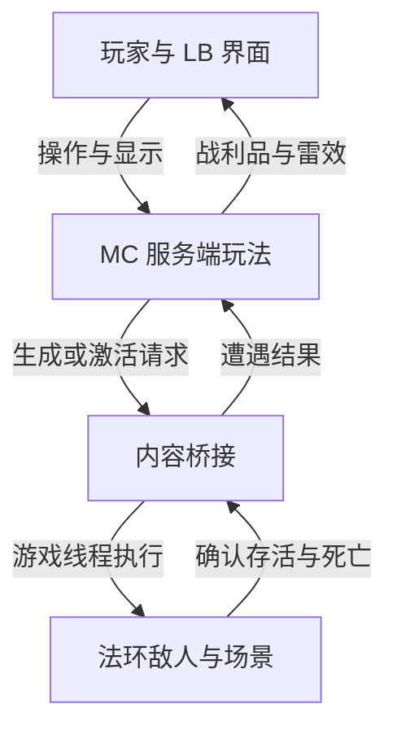

# Minecraft-Ring 玩法路线与 session 分工 v0.1

2026-10-12 · 新增方向规划  
代码评估基线：`dev/lb-poc` / `3e66a0b2780b72b60eeb0197bbc01c28db47be0b`  
配套：[本次 review](reviews/20261012-gameplay-readiness.md) · [review 工作约定](reviews/README.md)

## 1. 与原计划的关系

本文件增加玩法方向和后续工作线，不修改 [LB 开发方案](lb-development-plan.md)、[LB 实验计划](lb-experiment-plan.md)，也不把尚未通过的实验改写成通过。本轮仍推进真实 LiquidBounce 接入、GUI/视觉与 Fly/Velocity，以及影响这些实验的 Core 修复。运行事实以 [2026-10-12 检查点](experiments/20261012-checkpoint.md)及逐轮记录为准。

用户当前确定：LB 是成品中的角色能力层；后续还需要法环物品/装备与 MC 的结合，以及有资源、成长和目标的玩法。原方案中的自研小模块保底即使有诊断价值，也不能替代“真实 LB 接入成功”的成果。

推进方式为边玩边测、记录缺口、先完成可玩的短流程。非阻塞问题可以作为场景限制保留，例如暂时选择不依赖升降平台的路线；不能因此宣称平台已修复或原关卡全部通过。会导致无法游玩、物品重复结算或持久状态损坏的问题，必须在依赖它的流程中先解决。不要把后来想到的全部玩法能力变成当前 LB 实验的新前置条件。

## 2. 产品目标：交界地中的 UHC 风格远征

玩家看到地图上的遭遇点与补给点，选择路线获取材料和装备；接近某个点后触发法环敌人/Boss/红灵 NPC 遭遇；MC 侧结算确认的击杀，播放雷效和公告，并在场景中掉落可拾取装备；区域随时间收缩，把玩家引向最终目标。LB 提供经过验证的移动、战斗辅助和视觉能力。

灵感来自用户描述的 Hypixel UHC 式发育和击杀反馈；这里定义自己的规则，不声称已复刻该服务器的规则或实现。

首个完整模式先做单人 PvE 远征。它验证 UHC 所需的资源、计时、区域和淘汰/结算系统；多人 PvP 和共享法环敌人的 PvPvE 在后续独立验证。自由建造与主线通关可复用同一套物品、装备和能力，不强制使用缩圈规则。

“红灵”首版指法环风格的敌对 NPC，不依赖真实玩家入侵。

## 3. 三个 session，一个主仓库

这里的 session 是独立任务上下文和工作分支，不是要求同时运行三个 agent 或三套游戏。

| 工作线 | 范围 | 第一项可交付成果 | 不应扩大的方向 |
| --- | --- | --- | --- |
| A：LB + Core | 继续 `dev/lb-poc`；固定 LB、合成、输入、Fly/Velocity；修当前实验阻塞 | 一套真实 LB 的可复现展示与单项结果，保留已知问题表 | 为未来所有玩法重写碰撞、协议或全部属性 |
| B：内容与语义桥接 | 面向 MC 的法环背包、装备/消耗品，以及遭遇生成/死亡事件的必要接口 | 一个真实物品操作，以及一个能够确认开始、死亡、结束的遭遇 | 一次搬完所有法环武器、战技、法术和装备效果 |
| C：玩法 | MC 服务端的标点、阶段、缩圈、资源、掉落、雷效、胜负和重置 | 一张小区域配置、一段完整远征；早期可用测试后端验证规则 | 同时建设多人网络、大厅、匹配与大量小游戏 |

B 负责内容语义及必要的 ER 执行适配；A 负责公共连接、控制和底座。B 如需修改原生协议/底座文件，单独提交小改动交由 A 的集成分支吸收，避免两条线同时修改同一套 DLL 却无法区分实机制品。C 只消费已约定接口，不直接读取 ER 地址，不依赖 LB 内部实现。

当前先完成 A 的下一项可见成果；B/C 可先定数据和用测试后端串流程，不必等待所有 Core 缺陷修复。真实遭遇与物品的最终验收必须由 B + C 一起运行，测试后端通过不能写为法环通过。

各 session 使用独立 worktree/分支。B/C 从共同确认的集成提交开始，记录所依赖的 A/B 提交；不要各自从旧 `main` 重启项目。原生 DLL 与 MC 制品必须配套，实机一次只测一组，并记录实际加载版本。现在不新增第二、第三个仓库。

组件可以暂放现有工程的独立包，必要时再拆同仓库 Fabric 子项目。内容组件与玩法组件是职责划分，不要求立即产生两个新 JAR；本文件不创建空工程。

## 4. 玩法放在 MC 服务端，法环执行原生行为

| 层 | 决定/执行的内容 |
| --- | --- |
| MC 客户端 + LB | 界面、标记显示、输入、模块计算、画面特效；不自行决定掉落或遭遇胜利 |
| MC 逻辑服务端 | 遭遇触发、对局时间、阶段、资源、战利品、边界处罚、结算与玩法存档 |
| 内容桥接 | 把 MC 请求翻译成法环操作，发布带身份和结果的宿主事件，定义两边属性如何结合 |
| ER 原生侧 | 敌人生成/激活、AI、原生动作/攻击、真实存活状态、原生背包与装备操作 |

不建立两份独立敌人 AI 或 HP 结算。法环敌人的死亡由法环确认；MC 服务端根据确认事件发奖励。MC 玩家伤害继续走现有桥接流程，后续按玩法需要逐项明确装备叠加与状态规则。

### 服务器选择

第一版用现有 Fabric 客户端里的集成服务器：单人 MC 已经有逻辑服务端，规则仍写在服务端线程。单独搭服务器不是当前单人玩法的前提。

为未来迁移，玩法逻辑不调用客户端单例，也不依赖同 JVM 静态变量传递客户端状态。将来独立 Fabric Server 管对局，各玩家本机仍负责 MC 客户端和法环画面/进程。现有共享内存不能被云端服务器直接读取，需要增加本地适配器到服务器的网络通路及身份/权限校验；这部分尚未实现。

现有代码的伤害和死亡对所有 ServerPlayer 广播，是单宿主假设。多人前必须建立玩家—宿主对应关系。MC 玩家/方块同步、每位玩家的法环画面与地图状态一致、共享法环敌人同步是三个不同问题；打开 LAN 不会自动解决后两项。

Paper/Spigot 小游戏插件不能直接当作当前 Fabric 模组加载。初期优先数据包承载配方/掉落配置，Fabric 服务端逻辑处理桥接事件与对局。未来复用插件应单独评估兼容层与维护成本，不更换底座来追逐一个插件。

## 5. 一场遭遇如何闭环

以下为目标流程，尚未实现：

1. **标点。** 配置地图/区域、稳定坐标、触发半径、高度范围、敌人模板、奖励表与复用规则。持久坐标使用宿主稳定坐标和地图身份，运行时映射到 MC；不保存临时 Havok 坐标或原生指针。先做 MC 罗盘/界面地图/世界标记，法环原生地图图标另行评估。
2. **接近。** MC 服务端确认玩家处于对应区域、活跃阶段、连接有效且遭遇未完成，才请求触发。飞过触发点是否算进入由模式配置，不依赖客户端标记来裁决。
3. **生成或激活。** ER 执行已验证模板，返回成功及实例身份后才进入战斗。请求被接收不等于敌人已生成；加载失败/超时记为受阻，不放空奖励。
4. **战斗。** 使用法环 AI 与真实血量；MC 攻击继续经过代理桥接。目标离开采样范围、换图、断连或阶段切换都不能当作击杀。
5. **死亡与结算。** 取得明确死亡/遭遇完成事件。Boss 多阶段需要确认最终阶段完成。服务端按照同一结算 ID 发一次奖励，触发一次公告/雷效。
6. **掉落。** 初版生成少量真实 MC ItemEntity，支持拾取。法环原生装备先入法环权威背包并显示在桥接 UI；若要作为地面物品，使用只能兑换一次的领取凭证，不能复制一份无约束镜像。
7. **结束或重置。** 清理这场遭遇自己生成的敌人、标记和临时效果；一局一刷或冷却刷新由规则决定。中断恢复时从记录与宿主状态核对，不能盲目重发生成和奖励请求。

状态至少区分：未触发、等待生成、战斗中、已确认击杀、已结算、中断/失败。奖励记录需要区分未发、处理中、已确认；重启时核对未完成记录，不能用“内存中发过”代替持久去重。

### Boss 与红灵的真实边界

现有 `game.cpp` 有调试生成葛瑞克士兵的入口，不是任意 Boss/红灵工厂。Boss 的资源加载、AI、出生点、导航、多阶段和事件脚本需要逐模板验证；红灵 NPC 还涉及角色配置、敌对关系和装备行为。

先选一个敌人模板在一个已加载地点完成生成—战斗—清理。动态生成受阻时，可以先激活经过配置的预置敌人验证玩法，但必须标明“预置激活”；不能用 MC 僵尸替代测试后宣称法环 Boss 生成成功。

已有调试清理函数遍历 debug set 并清除其中角色，不能直接当作玩法的通用 cleanup。新接口只回收自身创建并记录的实例，避免清掉别的调试/模组角色。

### 缩圈与击杀雷效

首局限制在一个稳定地图区域，使用单独的对局时钟。MC 原版世界边界可作为方形边界候选；如果要圆圈、多个区域或跨地图边界，使用模式自己的区域判定。圈外处罚由服务端结算，LB Fly、传送、F8、读条的处理都要有明确规则，不能靠客户端视觉圈拦截。

单人初版建议 F8 交还控制、宿主读条或断连时暂停对局时间与奖励处理；恢复后核对遭遇。未来多人采用统一服务端时钟，不能由某位玩家打开菜单暂停全局。

击杀雷效默认仅视觉与音效，不造成额外伤害、起火或烧毁战利品；雷效从服务端确认的死亡事件触发。开启全局雷雨与一次击杀闪电不是同一件事。声音不要由两侧重复播放。最终需在 ER 合成画面中验证可见与可听。

## 6. 资源、双装备与建筑

资源先来自三条路径：场景里的 MC 资源点、确认击杀后的掉落、已验证的法环拾取/可破坏物件映射。具体配方和兑换比例配置化，不由底层原生代码写死。

法环库存是法环物品的权威数据，MC 原版物品归 MC 存档；法环风格 UI 显示真实库存并发送操作请求。第一批按“只读背包 → 一件装备的装备/卸下 → 一种消耗品”推进，每项验证重启后数量/状态以及实际效果。涉及兑换时明确唯一扣款和发放记录，操作失败/结果未知不能当成功再扣一次。

当前受击数据已经受宿主防御影响，之后还经过 MC 伤害处理，不能又把同一套法环减伤重复叠加。法环武器属性不会自动改变 MC 武器；每种效果明确实现于 ER、MC 或一次转换。两套装备允许共存，叠加规则由玩法决定。

建筑先用于搭桥、路线、补给与展示。现有代码没有把新 MC 方块反向注册为 ER 原生碰撞/导航的完整通路；守家、挡箭、困 Boss 在相关实验通过前不能算成品能力。任意挖穿法环地图和全图碰撞烘焙分别立项，不是首局的前置条件。

LB 自由模式和挑战预设分开：前者便于展示能力，后者约定可用模块/参数与必要代价。解锁/能量等规则属于候选玩法，不强制现在重写 LB。未来多人若有能力限制，要由服务端规则与校验共同约束，不能只信任客户端配置文件。

## 7. 分阶段成果

| 阶段 | 交付 | 验收重点 |
| --- | --- | --- |
| A 当前轮 | 原计划内的 LB 展示与 Fly/Velocity 单项结果，阻塞修复与缺陷记录 | 实际配置、提交和人工结果可复现；未通过项不改状态 |
| B 接口小样 | 一次真实物品操作、一个宿主遭遇生命周期 | 操作有结果；死亡与卸载可区分；仅清理自己创建的对象 |
| C 规则小样 | 标点、触发、计时、缩圈、掉落和雷效，可先用测试后端 | 规则可以完整运行；测试数据不算 ER 验收 |
| B + C 首局 | 建议 20–30 分钟、一个区域、三个候选点、两类资源、一个最终目标 | 不靠临时命令补物品能完成发育与结算；切换/重启不会重复领奖 |
| 后续 | 红灵模板、更多 Boss/装备、通关路线、多人 PvP/PvPvE | 每个扩展验证对应原生能力、同步与平衡，不整体宣称兼容 |

首局候选点可以使用“补给点、精英遭遇点、最终目标点”。能力先小而完整，数量和时长在实际游玩后调整；当前不承诺具体工期或所有 Boss 可移植。

UHC 模式需要单独定义死亡后淘汰/结算、治疗、自然回血、祝福休息与掉落规则。现有 Core 会立即复活、请求回归且保留 MC 物品；玩法必须协调这条路径，不能仅设 hardcore 然后与 Core 相互覆盖。模式结束恢复它自己改动前的游戏规则；原实验尚待恢复的 `naturalRegeneration` 要与新模式配置区分。

## 8. 最小接口与工作交接

下面是接口语义候选，不是当前协议已经存在的字段：

| 能力 | 请求/事件示例 | 第一个用途 |
| --- | --- | --- |
| 场景状态 | 地图身份、稳定坐标、已加载/可操作、生命期 | 正确触发标点，暂停无效场景 |
| 遭遇 | 生成/激活模板、确认实例、确认最终死亡、回收实例 | 刷怪和一次结算 |
| 背包/装备 | 库存快照、装备/卸下/使用、结果与修订 | MC 风格法环背包 |
| 交互/奖励 | 确认拾取、确认破坏、领取结果 | 资源和跨游戏物品 |

对会改变库存或生成实例的请求，最少带请求身份、会话/场景身份及结果确认，以拒绝过期和重复执行；不要求先重构所有旧协议。事件应区分击杀、卸载、强制清理和未知消失。玩法只处理明确支持的能力，未知不按成功处理。

每个 session 的交接至少写：实际提交和制品、完成的能力、已知限制、复现步骤、实测/模拟的区别、下一项验收。未来 review 写入 `docs/reviews/`，实验结果写入 `docs/experiments/`；有对应 PR 时把代码定位和处理决定留在 PR review/thread。聊天只报告关键结论与仓库链接。

## 9. 来源与证据

- 本项目代码与运行记录：见 [2026-10-12 review](reviews/20261012-gameplay-readiness.md)，固定到上述提交；本规划没有新增游戏运行验证。
- [Elden Ring Debug Tool](https://github.com/Nordgaren/Elden-Ring-Debug-Tool)：已展示背包读取和物品生成，是调研线索；不是本桥接目标版本的自动兼容保证。
- [DarkScript3 ER 指令参考](https://soulsmods.github.io/emedf/er-emedf.html)：原生事件、物品奖励等能力线索，不等同于当前 Bridge 已实现这些接口。
- [Paper 插件说明](https://docs.papermc.io/paper/adding-plugins/)：Paper 插件与 Fabric 模组属于不同加载体系。
