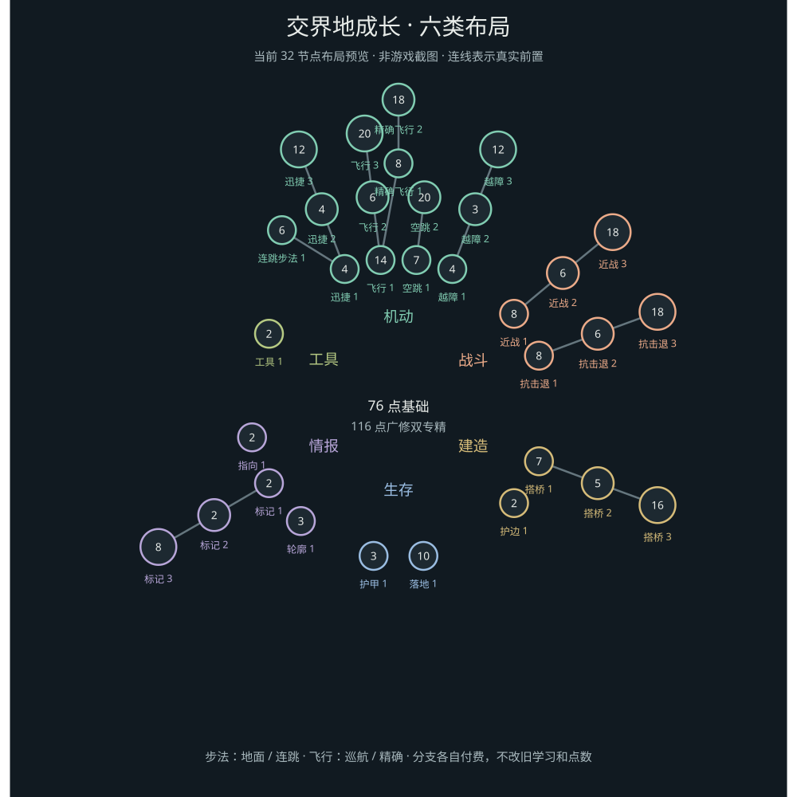

# 成长路线研究：从加数值到选玩法

2026-10-14。用户举出 Fly 的速度/自由、Speed 的 BHop/YPort 作为方向。本页区分本批已经实现的展示修复与后续可落地的玩法分支，不把换布局当作已经有策略系统。

## 本批已经改变什么

0.3.3 保留现有 14 项、29 节点、节点 ID、前置与价格，不动已经实测的 Speed II/真实点数。树改为六个环形区域，入门在内、精通在外，以不同框型/尺寸区分层次；工具提示改为具体收益和限制。图标走 Skills 原版物品渲染，盾、指南针、砖块不再拼不存在的 PNG 路径。

这是生成坐标的矢量预览，不是游戏截图。玩法仍是目前各能力的阶梯；真正的分支需要下面的节点/授权改造，不能靠把线画弯实现。

## 固定 LB 中实际有什么

依据只读源码 `e5a0dbf5458b063d3028e69e04762b8b25b998b5`，不引入新版算法。

| 候选 | 已有实际行为 | 设计判断 |
| --- | --- | --- |
| Speed Custom 地面路线 | 原 Strafe 有速度、方向强度等设置；目前关闭 BHop 和垂直修改 | 保留低风险、可预期的地面疾行路线 |
| Speed LegitHop / Custom BHop | `SpeedBHopBase` 在着地且移动时触发原跳跃输入 | 适合作为连跳路线；要测斜坡、楼梯、低顶和受击，而不是把它视为单纯更快 |
| Speed YPort | 速度硬编码 0.4，向上 0.42，一 tick 后向下 1；没有可直接分级的速度参数 | 目前先列实验。急速向下与已有地形采样/平台问题相冲突；不能用正常速度滑块假装已限制它 |
| Fly Creative | 设置 flySpeed、冲刺速度、最大速度；可强制持续飞行 | 适合巡航路线。本版入门已经能无限悬停，不能再把“无限悬停”当作未学的后期收益 |
| Fly Vanilla | 横向、纵向、冲刺速度各自独立；松键的升降由 Glide 控制 | 可做精确悬停/升降路线；数值含义与 Creative flySpeed 不同，不能直接拿 0.1 对 0.1 比速度 |
| Fly AirWalk / 特定反作弊模式 | 修改脚下碰撞、onGround或依赖特定服务器行为 | 不作为成长奖励直接开放，以免破坏桥接的碰撞/坠落语义 |

参考：[SpeedGeneric](https://github.com/CCBlueX/LiquidBounce/blob/e5a0dbf5458b063d3028e69e04762b8b25b998b5/src/main/kotlin/net/ccbluex/liquidbounce/features/module/modules/movement/speed/modes/SpeedGeneric.kt)、[SpeedCustom](https://github.com/CCBlueX/LiquidBounce/blob/e5a0dbf5458b063d3028e69e04762b8b25b998b5/src/main/kotlin/net/ccbluex/liquidbounce/features/module/modules/movement/speed/modes/SpeedCustom.kt)、[FlyGeneric](https://github.com/CCBlueX/LiquidBounce/blob/e5a0dbf5458b063d3028e69e04762b8b25b998b5/src/main/kotlin/net/ccbluex/liquidbounce/features/module/modules/movement/fly/modes/FlyGeneric.kt)。

## 建议的两条首发分支

先做玩法差别明确的 Speed 和 Fly，保留其他能力的实用基础，不给所有单开关功能硬凑三档。

| 能力 | 路线 A | 路线 B | 取舍 |
| --- | --- | --- | --- |
| Speed | 地面疾行：低跳动、稳定转向 | 连跳：以持续起跳和空中衔接穿行 | 低顶、狭窄地面偏地面；开阔路线偏连跳，配 Step/AirJump 的成本不同 |
| Fly | 巡航：较高水平/冲刺速度，普通升降 | 精确操控：独立升降、低速定位与悬停 | 长距离赶路与建筑/窄处定位的选择，不能把 B 设计成 A 的全面升级 |

“自由飞行”如果指更长续航、摆脱高度限制或空中充能，需要单独加入真实的资源/时间/高度约束。固定 LB 的 Creative 并不提供这些限制。本批没有偷偷增加一个飞行计时器，也没有把 BypassVanillaCheck 当作自由度奖励。

成本候选沿用约 100–120 点的通关目标：

- 全部基础仍以 76 点为预算基准。
- Speed 公共入门 4 点已包含在基础中。地面后续 4+12；连跳候选 6+10，两条各需额外16点。
- Fly 公共入门14点已包含在基础中。巡航后续6+20；精确操控候选8+18，两条各需额外26点。
- 广修 + 一条 Speed 路线 + 一条 Fly 路线约118点；广修 + Speed/Aura 两项精通仍可约116点。
- 可以投入更多点学第二路线，但同一模块一次只选一种模式；通过机会成本鼓励专精，先不做不可逆职业锁。

这些是尚未应用的设计预算。现有0.3.3仍按成长v1消费，不能将候选成本写进旧存档而不迁移。

## 实现需要改哪里

Skills 原框架本来支持普通前置和互斥连接；瓶颈在本项目把每个能力压成一个线性 `rank`。新增路线应改成“已学节点集合 → 当前可选模式与参数”，让 Skills 继续拥有消费/退款；不要再造一份技能点账本。

1. 稳定节点 ID 分出公共入门、路线节点与专精节点；模式/数值按所选路线计算。
2. ClickGUI 展示已学路线；切换模式时正常执行原 LB 模块的停用/启用清理，避免上一模式残留。
3. 对旧 speed_1/2/3 和 fly_1/2/3 提供明确映射或可恢复退款。保持原173级、真实累计额度9等账本不变，不要求刷级补迁移差额。
4. 用真实 Skills 前置、可负担状态、退款和预设检查非线性购买；测试从A切B、两路线都学、退款当前路线、菜单暂停与重进。
5. 先单独验证 BHop/Vanilla Fly 在桥接地形和服务端上的行为，再把对应节点开放给普通挑战流程。YPort需先证明不会产生急坠/纠正包循环。

[Skills连接/状态文档](https://puffish.net/skillsmod/docs/creators/configuration/roots)支持这类数据图谱，但不意味着本项目已完成路线授权。

## 与建造和战斗成长的关系

建造路线应获得“能采集、能放置且能挡住敌人的建筑”，而非只有放置速度。资源采集/原生碰撞一旦落地，可以形成资源→搭建掩体→较安全战斗的投入回报；这比继续加 Scaffold 隐藏参数更有策略价值。战斗则保留 Aura距离与Velocity抗击退的不同投入，不把所有自动功能捆绑免费开启。相关机制见 [EldenCraft研究](eldencraft-physics-research.md)。
