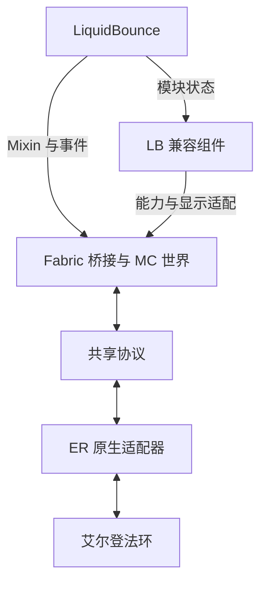

# Minecraft-Ring × LiquidBounce 开发方案 v0.2

2026-10-11 · 架构与仓库决策  
主仓库：https://github.com/0smium/Minecraft-Ring  
配套执行单：[实验计划 v0.3](lb-experiment-plan.md)

> 本文规定项目形态、职责和长期方向；本轮执行顺序、时间盒、退出条件以实验计划为准。当前只完成静态源码调研与文档整理，尚未构建、启动游戏或验证共载。文中的“支持目标”“通过标准”均不代表已经实测通过。

## 1. 已决定的项目形态

第一阶段是在 Windows 上同时运行艾尔登法环和真实 Minecraft，在参与桥接的那个 MC 实例里加载固定版本 LiquidBounce。玩家通过 MC 移动、建造、物品和战斗机制参与法环世界，并使用经过验证的 LB 界面、视觉效果和少量移动功能。

产品由公共桥接、法环后端、LB 兼容组件、配置和启动工具组成。现在沿用 Minecraft-Ring Fork；优先复用 LB 本体，针对不一致的语义做小范围适配。

提供三种明确的运行配置，其中第三种只在共载路线受阻时开发：

| 配置 | 组成 | 用途 |
| --- | --- | --- |
| Core | 原生桥接 + Fabric 桥接 | 基线、故障对照 |
| LB | Core + 固定 LB + 必要兼容组件 + 预设 | 主路线：LB 界面、视觉与功能 |
| Bridge Tools | Core + 小型独立功能模块 | 保底路线：Fly、Velocity，以及简单状态 HUD |

“Bridge Tools 成功”只证明桥接能力可实现，不代表已经验证 LB 兼容。所有实验配置记录实际启用的模块、依赖和提交。

短期成果是可复现的原型及可录制的演示；正式启动包、全面恢复机制和 Nightreign 后端在后续阶段完成。首轮沿用上游的离线运行方式；现有桥接器检测到 Easy Anti-Cheat 时不会激活。[S3]

## 2. 仓库数量：目前一个主开发仓库

**现在无需新建第二或第三个仓库。** “组件数量”“构建产物数量”和“仓库数量”不需要一致。原生 DLL、Fabric 桥接 JAR、兼容 JAR 可以在同一个 Git 仓库里开发并通过一个提交记录它们的配套关系。

| 对象 | 现在放哪里 | 是否主动开发 |
| --- | --- | --- |
| Bridge 公共修复、ER 后端 | `0smium/Minecraft-Ring` 现有目录 | 是 |
| LB 兼容组件、保底模块 | 同仓库的独立包或子项目 | 按实验需要建立 |
| 两份开发文档、预设、实验记录 | 同仓库 `docs/` 等目录 | 是 |
| LiquidBounce 本体 | 固定官方制品；外部只读源码副本 | 暂不改、不另开 Fork |
| siddoff 上游 | Git remote `upstream` | 读取、审查和吸收改动 |
| 展示视频和大体积运行日志 | 工作目录或单独交付位置 | Git 中只存摘要与引用 |

后续只有两种情况考虑拆仓库：

1. 已确认某个必要功能必须修改 LB 本体，独立兼容组件无法可靠实现：届时建立 LB Fork。主仓库仍是文档和集成入口；LB Fork 只放必要补丁，并锁定到明确提交/制品。
2. 公共桥接已有多个独立游戏后端或外部使用者，需要独立版本和发布周期：再评估公共 SDK 仓库。当前 ER 原型不需要第三个仓库。

若将来有两个开发仓库，也只对涉及 LB 内核的任务跨仓库推进：先定位修改边界，分别提交，主仓库更新依赖锁定并跑集成实验。单纯修 ER 或公共协议无需同步改 LB。

## 3. 文档和目录落点

| 路径 | 职责 | 当前状态 |
| --- | --- | --- |
| `docs/lb-development-plan.md` | 本总方案，架构、仓库和长期边界 | 本次新增 |
| `docs/lb-experiment-plan.md` | 本轮实验步骤、视觉展示、时间盒和记录模板 | 本次新增 |
| `docs/development.md`、`docs/installation.md` | 保留上游技术与安装说明 | 已有，继续引用 |
| `bridge-base/elden-ring/er-bridge/` | Windows 原生桥接与 ER 后端 | 已有 |
| `bridge-base/elden-ring/mc-bridge/` | Fabric 桥接、世界、代理和同步 | 已有 |
| `integrations/liquidbounce/` | 独立兼容组件候选位置 | 需要时建立 |
| `integrations/bridge-tools/` | 保底模块候选位置 | 走保底时建立 |
| `profiles/` | Core/LB/保底预设及依赖清单 | 实验验证后建立 |
| `docs/experiments/` | 每次实验的精简记录 | 实际执行时建立 |

候选目录不是已完成模块，不提前创建空框架。LB 源码参考克隆放在主仓库外；本轮不引入子模块，也不把整份 LB 源码复制进来。

代码仓库中的两份文档作为开发依据，变更与代码通过同一 PR/提交审查。现有可阅读文档保留入口并标明仓库来源。若旧副本与仓库的后续版本不同，以正在开发分支的文档为准。

## 4. 固定技术基线

| 组件 | 基线 |
| --- | --- |
| Bridge 原始代码提交 | `711015afa67ab25c7b9597c68038718d1cef322e`，源码版 0.3.0 |
| 自己的 Fork / 上游 | `0smium/Minecraft-Ring` / `siddoff/Minecraft-Ring` |
| ER 目标 | App 1.17.1；`eldenring.exe` 2.7.1.0，运行前检查实际版本 |
| Minecraft | Java 1.21.1 |
| Bridge Fabric | Loader 0.19.5；API 0.116.17+1.21.1 |
| Bridge 构建 | JDK 25、Gradle 9.7.1、Loom 1.18.2；Java 输出目标 21 |
| LB 候选 | v0.22.0，官方 Build #3530 |
| LB 提交 | `e5a0dbf5458b063d3028e69e04762b8b25b998b5` |
| LB 发布时依赖 | Loader 0.16.9；API 0.110.0+1.21.1；Kotlin 2.1.0 |
| Fabric Language Kotlin | 1.13.0+kotlin.2.1.0 |
| 原生构建 | Windows x64 LLVM-MinGW、Python 3 |

LB 官方已将该版本标为旧版，本项目因 MC 版本匹配而选择它。两套依赖尚未共载验证；运行时只安装一套 Loader/API，不把双方版本各装一份。[S3][S4][S5][S6]

原生代码基线与项目后续 HEAD 分开记录：新增文档或适配后，项目 HEAD 会变化，不能仍把它写成 `711015a`。实验同时记录“实际工作提交”和“原始代码基线”。

## 5. 架构职责

图中是逻辑层次，不是六个仓库。保底模块在 MC 一侧使用相同的桥接入口；帧合成继续沿用现有链路。

| 层 | 负责 |
| --- | --- |
| LB | 界面、配置、热键、模块计算、MC Mixin 与事件 |
| 兼容组件 | 将模块状态转成公共能力；适配视觉实体筛选、显示血量及必要事件 |
| Fabric 桥接 | MC 世界、玩家、实体代理、伤害转换、能力仲裁、生命周期同步 |
| 协议 | 版本、状态快照、控制、事件和命令；后续按证据扩展会话/时效 |
| ER 后端 | 版本定位、角色状态、游戏线程读写、原生机制接管与恢复 |

原生后端不认识 LB 模块名，LB 不接触 ER 裸地址。兼容层优先独立 Fabric JAR；其实现可以锁定 LB 内部 API 的版本，但不要假定存在稳定的通用插件 ABI。ScriptAPI 可用于有限探针和胶水逻辑。[S7]

公共性目标是复用“飞行状态、控制权、伤害、可视目标”等语义。任意 MC 模组仍可能需要小适配，不承诺全部零修改兼容。

## 6. 当前执行范围和里程碑

**本轮依次执行关卡 0 → 1 → 1.5 → 2。** 细节和时间盒只在配套实验计划中维护。

| 阶段 | 目标 | 边界 |
| --- | --- | --- |
| 0 Core 基线 | 悬停、平台、实际伤害与击退、启停 | 无 LB |
| 1 LB 共载 | 依赖、Mixin、UI、输入、帧合成 | 不超过一天；按实验计划止损 |
| 1.5 视觉展示 | GUI/HUD、自身特效、有限实体显示及录制验证 | 半天预算；单个视觉失败不阻塞关卡 2 |
| 2 两项功能 | FlyCreative、Velocity Modify | 单项启用，定位失配层 |
| 保底 | 小模块实现 Fly、Velocity 和基本状态提示 | 共载受阻后停止 LB 调试；其余功能暂缓 |
| 后续稳定化 | 会话、控制恢复、伤害来源、读图等已证实问题 | 不作为全部前置工作 |
| 正式版本 | 固定实例、版本清单、启动和恢复包 | 日常使用不依赖 Gradle |
| 后续移植 | 其他客户端适配，再评估 Nightreign | ER 契约稳定后启动 |

首批视频成果优先展示“法环场景中的 LB 面板、状态 HUD、轨迹/跳跃效果、敌人标记”。Fly 通过后加入飞行片段，Velocity 用受击对照展示。录屏通过也是展示能力的验收条件。

## 7. 功能语义与复用边界

| 功能组 | 在本项目中的含义 | 适配重点 |
| --- | --- | --- |
| ClickGUI、模块列表、按键、通知 | MC/LB 界面叠入法环画面 | JCEF、透明度、焦点、比例、最终录制 |
| Breadcrumbs、JumpEffect | MC 玩家在法环场景里的运动轨迹与跳跃特效 | 世界坐标、绘制时机、关闭和切场景后的清理 |
| ESP Box、Tracers、Nametags | 标记法环角色的 MC 代理 | 视觉筛选、包围盒、名称、距离、生命状态 |
| 血条、TargetHUD | 显示真实法环目标及 HP | 显示数据映射与目标选取 |
| FlyCreative | 客户端原版飞行能力驱动移动 | 集成服务器状态、平台吸附、关闭后权限恢复 |
| Fly Vanilla | 直接改变 MC 速度的飞行 | 明确飞行声明，两侧一致，暂不作为首测 |
| Velocity Modify | 缩放/取消 MC 层收到的受击速度更新 | 保留伤害；区分 ER 动画、抓取与强制位移 |
| Speed、Sprint、AirJump | 其他 MC 移动能力 | 两项核心通过后分别读源码与验证 |
| NoFall | MC 跌落保护与 ER 坠落机制分别处理 | 不能等同于一个 fallDistance 属性 |
| SafeWalk、Scaffold、InventoryMove | MC 方块/移动/界面能力 | 碰撞边界、采样和控制切换，后置 |
| Glow、Outline、Chams | 对模型轮廓/材质的效果 | ER 模型不在 MC 中，另行研究 |
| Trajectories、ItemChams | MC 投射物/手持物品展示 | 不默认覆盖 ER 原生武器和投射物 |
| KillAura、原生连招/翻滚自动化 | 新的目标或动作控制范围 | 不进入本轮 |
| Blink、Backtrack、Disabler、Timer、服务器专用模式 | 网络或时间语义相关能力 | 本轮关闭 |
| XRay、矿物类功能 | MC 方块语义 | 不作为法环资源识别目标 |

### 7.1 本次调研已明确的细节

- LB Fly Vanilla 不设置原版飞行标志，并默认带周期性下移行为；实验中关闭 `BypassVanillaCheck`。FlyCreative 会修改客户端能力，但不能据此认定集成服务器玩家已同步；关闭模块还会直接清掉 `allowFlying/flying`。[S10][S11]
- LB 的视觉筛选不接受任意 LivingEntity；Bridge 的 ErEntity 需要显式接入。ESP、Tracers、Nametags 共用筛选，可以集中适配。[S21]
- ErEntity 已有自定义 `hp()/maxHp()` 同步字段，LB 默认 MC health 读取不会自动使用它们。优先在显示适配层读取宿主 HP，维持现有战斗语义。[S22]
- ErEntity 正常不绘制怪物网格；真实模型由 ER 绘制。Box/线条与模型 Glow/Chams 是不同工作量。[S23]
- 现有世界层会受到 ER 深度遮挡，HUD 层直接叠加。LB 的世界空间 ESP 不自动拥有跨宿主穿墙能力。[S17][S24]
- `711015a` 中 BlockGetterMixin 等额外碰撞 Mixin 未注册。不能把存在于源码中的停用文件算作当前正在生效的冲突。[S25]
- `client` Mixin 配置指加载环境；对通用类的注入在同 JVM 中可能涉及服务端实例。具体事件和修改是否执行，取决于注入位置、实例类型和线程/状态条件，仍需核查对应代码。

## 8. 共载和构建边界

Bridge 使用 Mojang mappings，LB 使用 Yarn。开发映射不同不直接等于发布制品不兼容；Loom 负责 mod 依赖重映射，但实际依赖声明、嵌套库和 Mixin 仍需运行验证。[S4][S6][S13]

原 `Launch.ps1` 运行 `remapJar runClient`。首轮以固定 LB JAR 的 `modRuntimeOnly` 依赖作为候选路线，不把未验证的配置写成已经工作的安装方法。正式生产实例在共载稳定后处理。[S14]

LB 缺依赖时下载 JCEF，缓存齐全可直接初始化；下载/初始化错误可进入 fatal 退出路径。下载失败记为“依赖准备受阻”，与“已证明代码不兼容”分开记录。选择停止排障是本轮时间预算决策。

## 9. 状态与接口的后续目标

当前 MC 控制移动并承受桥接后的伤害，隐藏 ER 角色作为受击代理；宿主负责原生死亡/复活流程。F8、暂停、读图和断线期间必须知道当前由谁控制，不能把“角色活着”当作“MC 可接管”。[S8][S9]

以下是后续设计目标，不要求在本轮统一实现：

| 接口内容 | 作用 |
| --- | --- |
| 协议版本、结构大小、能力集合 | 成套版本匹配，明确不支持项 |
| 会话、场景、生命期及快照年龄 | 隔离旧进程、读图前和上一生命期数据 |
| 控制归属、序号和有效期 | 明确接管和撤销 |
| WALK / AIRBORNE / FREE_FLIGHT 等移动语义 | 不依赖某个客户端恰好修改原版字段 |
| 伤害原因、来源可信度、事件标识 | 区分普通受击、状态伤害和未知原因 |
| 请求标识、截止条件和结果 | 防止迟到攻击/交互跨场景执行 |
| 有限机制接管及原值恢复 | 只改变当前能力需要的机制 |
| 视觉目标和显示数据 | 复用分类、名称、宿主 HP、位置和有效性 |

现有共享头已有进程、启动时间和 core generation；后续利用并完善这些信息，不假装原来完全没有会话概念。[S15]

首轮若需要共享飞行声明，可在集成服务器原型中使用明确的线程安全状态：按玩家/世界区分，有内存可见性，模块关闭、F8 交还、断开和世界卸载时清理。单个未同步、永不复位的静态 boolean 不足以作为契约。是否升级为 MC 客户端/服务端消息接口，由实验结果决定；这不要求立即重构 native 协议。

## 10. 底座问题清单

以下保持稳定编号，便于实验记录引用。“源码确认”不等于已在目标机器复现。P0/P1 是影响判断，不是要求开工前全部修完。

| 编号 | 已知情况与验证任务 | 本轮处理 |
| --- | --- | --- |
| B01 | 控制更新超时、旧快照读取、释放时原值恢复不完整 | 观察；若影响下一次实验，局部修复 |
| B02 | 飞行标志与 LB 状态不一致，平台两侧判定可能冲突 | Fly 阻塞时处理 |
| B03 | HP 钳制启发式与真正悬空死亡来源未区分 | 悬停失败时先诊断，暂停进入下一关 |
| B04 | HP 差额不能确定状态身份；将无攻击者损失直接扣成 custom status 仍可致死 | 用户在中毒污染基线后扩大本项：读取真实 Poison，集中映射 MC 原版效果并撤掉重复扣血；见[状态映射](host-state-mapping.md)，其他状态暂不猜测 |
| B05 | 多击可能聚合为一次差额，来源信息不完整 | 记录限制，后续事件粒度专项 |
| B06 | 请求缺完整会话/场景/时效；已有目标有效性检查 | 本轮不全面改协议；旧命令干扰时局部修复 |
| B07 | F8、既有 GUI 与两个游戏暂停规则不同 | 共载和 GUI 必测 |
| B08 | reach_assist 可改变隐藏身体位置 | 若污染受击实验，记录并限制交互场景 |
| B09 | 身体位姿提交与帧捕获就绪耦合 | 记录帧时间和位姿年龄，证实阻塞后再拆分 |
| B10 | 地形预取有预算，实体采样失败可能移除代理 | 限制速度；视觉标记闪烁时定位 |
| B11 | MC 方块不等于完整进入 ER 敌人/投射物物理世界 | 后续碰撞实验 |
| B12 | 梯子、抓取、骑乘等动作未完整建模 | 本轮不做，保留原生操作回退 |
| V01 | ER 代理不通过 LB 默认视觉筛选 | 视觉第二批的集中适配点 |
| V02 | 自定义宿主 HP 与 MC health 不同 | 血条/TargetHUD 展示前处理 |
| V03 | 绘制时机、宿主深度和最终录制路径 | 关卡 1.5 分项验证 |

原生坠落、抓取、骑乘和韧性字段在社区类型库中有线索，但字段偏移与机制效果必须在目标版本确认。先只读诊断，不用全局无敌或关闭全部动画掩盖原因。当前不引入 libER/Rust 作为强制依赖。[S19][S20]

## 11. 开发和上游维护方式

一次只推进一个可验证问题：复现 → 找到责任层 → 小范围提交 → 重跑相关实验。公共 Bridge 修复、LB 兼容、展示预设分开提交；native/Fabric 协议配套修改放在同一提交或明确的一组提交中。

上游维护：fetch → 阅读 diff 和依赖 → 在集成分支吸收 → 跑受影响场景 → 合并自己开发线。只更新自己的 Fork；保持 upstream 推送禁用。不要自动合并所有上游改动。

文档分支为 `docs/lb-plans-20261011`。它只有规划文档，原生代码基线不变。后续可在该分支上建立 `dev/lb-poc`；文档合入自己的 main 后，则从更新后的 main 开始。不要为了“固定基线”从旧 `711015a` 重新切分支而丢掉新文档。

如果未来建立 LB Fork，主仓库的依赖清单应记录 LB 提交、制品哈希与对应补丁链接。先固定一个兼容组合，再升级；不要求两个仓库的主分支永远同步前进。

Bridge 的 MIT 与 LB 源码的 GPL-3.0-or-later 标识分别保留。当前优先使用外部 LB 制品；保底模块独立实现行为，不复制 LB 实现。分仓库本身不会消除代码复用的许可义务；发行时按实际源码来源和组合整理许可材料。[S1][S2]

## 12. 后续执行入口

后续开发从[实验计划](lb-experiment-plan.md)关卡 0 开始，先产出 Core 基线。关卡 1 只做固定版本共载；通过后先跑视觉展示，再单项验证 FlyCreative 和 Velocity。遇到止损条件转保底，不扩展为 LB 全模块迁移。

当前调研足够开始这些实验；没有运行环境时，只记录静态结论，保留“未执行”。本轮不以完善全部公共接口、正式打包或移植 Nightreign 为完成条件。

## 13. 资料索引

Bridge 与 LB 的源码依据固定到上述提交。源码结构证明实现路径存在，不证明运行行为已经通过。

- [S1] Bridge 许可；[S2] LB 许可与源文件许可头。
- [S3] Windows 安装、工具链和恢复；[S4] Bridge 构建；[S5] LB 固定发布；[S6] LB 构建。
- [S7] LB ScriptAPI；[S8] ER 控制/生命/动作实现；[S9] MC 伤害转换。
- [S10] Fly 两种模式；[S11] 相机与飞行标志；[S12] Velocity Modify。
- [S13] Loom；[S14] 当前启动；[S15] 共享协议。
- [S16] F8 与 GUI；[S17] 帧捕获；[S18] 地形预算。
- [S19] fromsoftware-rs 角色模块；[S20] libER。
- [S21] LB 目标筛选；[S22] ER 代理数据；[S23] 代理渲染器；[S24] 原生合成；[S25] 启用的 Mixin 清单。

[S1]: https://github.com/siddoff/Minecraft-Ring/blob/711015afa67ab25c7b9597c68038718d1cef322e/LICENSE
[S2]: https://github.com/CCBlueX/LiquidBounce/blob/e5a0dbf5458b063d3028e69e04762b8b25b998b5/LICENSE
[S3]: https://github.com/siddoff/Minecraft-Ring/blob/711015afa67ab25c7b9597c68038718d1cef322e/docs/installation.md
[S4]: https://github.com/siddoff/Minecraft-Ring/blob/711015afa67ab25c7b9597c68038718d1cef322e/bridge-base/elden-ring/mc-bridge/build.gradle
[S5]: https://liquidbounce.net/download/3530
[S6]: https://github.com/CCBlueX/LiquidBounce/blob/e5a0dbf5458b063d3028e69e04762b8b25b998b5/build.gradle
[S7]: https://github.com/CCBlueX/LiquidBounce/blob/e5a0dbf5458b063d3028e69e04762b8b25b998b5/src/main/kotlin/net/ccbluex/liquidbounce/script/bindings/api/ScriptClient.kt
[S8]: https://github.com/siddoff/Minecraft-Ring/blob/711015afa67ab25c7b9597c68038718d1cef322e/bridge-base/elden-ring/er-bridge/src/game.cpp
[S9]: https://github.com/siddoff/Minecraft-Ring/blob/711015afa67ab25c7b9597c68038718d1cef322e/bridge-base/elden-ring/mc-bridge/src/main/java/dev/ermc/bridge/entity/CombatBridge.java
[S10]: https://github.com/CCBlueX/LiquidBounce/blob/e5a0dbf5458b063d3028e69e04762b8b25b998b5/src/main/kotlin/net/ccbluex/liquidbounce/features/module/modules/movement/fly/modes/FlyGeneric.kt
[S11]: https://github.com/siddoff/Minecraft-Ring/blob/711015afa67ab25c7b9597c68038718d1cef322e/bridge-base/elden-ring/mc-bridge/src/client/java/dev/ermc/bridge/client/CameraSync.java
[S12]: https://github.com/CCBlueX/LiquidBounce/blob/e5a0dbf5458b063d3028e69e04762b8b25b998b5/src/main/kotlin/net/ccbluex/liquidbounce/features/module/modules/combat/velocity/mode/VelocityModify.kt
[S13]: https://docs.fabricmc.net/develop/loom/
[S14]: https://github.com/siddoff/Minecraft-Ring/blob/711015afa67ab25c7b9597c68038718d1cef322e/Launch.ps1
[S15]: https://github.com/siddoff/Minecraft-Ring/blob/711015afa67ab25c7b9597c68038718d1cef322e/bridge-base/elden-ring/er-bridge/include/bridge_protocol.h
[S16]: https://github.com/siddoff/Minecraft-Ring/blob/711015afa67ab25c7b9597c68038718d1cef322e/bridge-base/elden-ring/mc-bridge/src/client/java/dev/ermc/bridge/client/Overlay.java
[S17]: https://github.com/siddoff/Minecraft-Ring/blob/711015afa67ab25c7b9597c68038718d1cef322e/bridge-base/elden-ring/mc-bridge/src/client/java/dev/ermc/bridge/client/FramePassthrough.java
[S18]: https://github.com/siddoff/Minecraft-Ring/blob/711015afa67ab25c7b9597c68038718d1cef322e/bridge-base/elden-ring/mc-bridge/src/main/java/dev/ermc/bridge/TerrainPrefetch.java
[S19]: https://github.com/vswarte/fromsoftware-rs/tree/59fbd3b3b7daaf14aca47c9f73530493dba6bc79/crates/eldenring/src/cs/chr_ins/module
[S20]: https://github.com/Dasaav-dsv/libER
[S21]: https://github.com/CCBlueX/LiquidBounce/blob/e5a0dbf5458b063d3028e69e04762b8b25b998b5/src/main/kotlin/net/ccbluex/liquidbounce/utils/combat/CombatExtensions.kt
[S22]: https://github.com/siddoff/Minecraft-Ring/blob/711015afa67ab25c7b9597c68038718d1cef322e/bridge-base/elden-ring/mc-bridge/src/main/java/dev/ermc/bridge/entity/ErEntity.java
[S23]: https://github.com/siddoff/Minecraft-Ring/blob/711015afa67ab25c7b9597c68038718d1cef322e/bridge-base/elden-ring/mc-bridge/src/client/java/dev/ermc/bridge/client/ErEntityRenderer.java
[S24]: https://github.com/siddoff/Minecraft-Ring/blob/711015afa67ab25c7b9597c68038718d1cef322e/bridge-base/elden-ring/er-bridge/src/compositor.cpp
[S25]: https://github.com/siddoff/Minecraft-Ring/blob/711015afa67ab25c7b9597c68038718d1cef322e/bridge-base/elden-ring/mc-bridge/src/main/resources/erbridge.mixins.json
