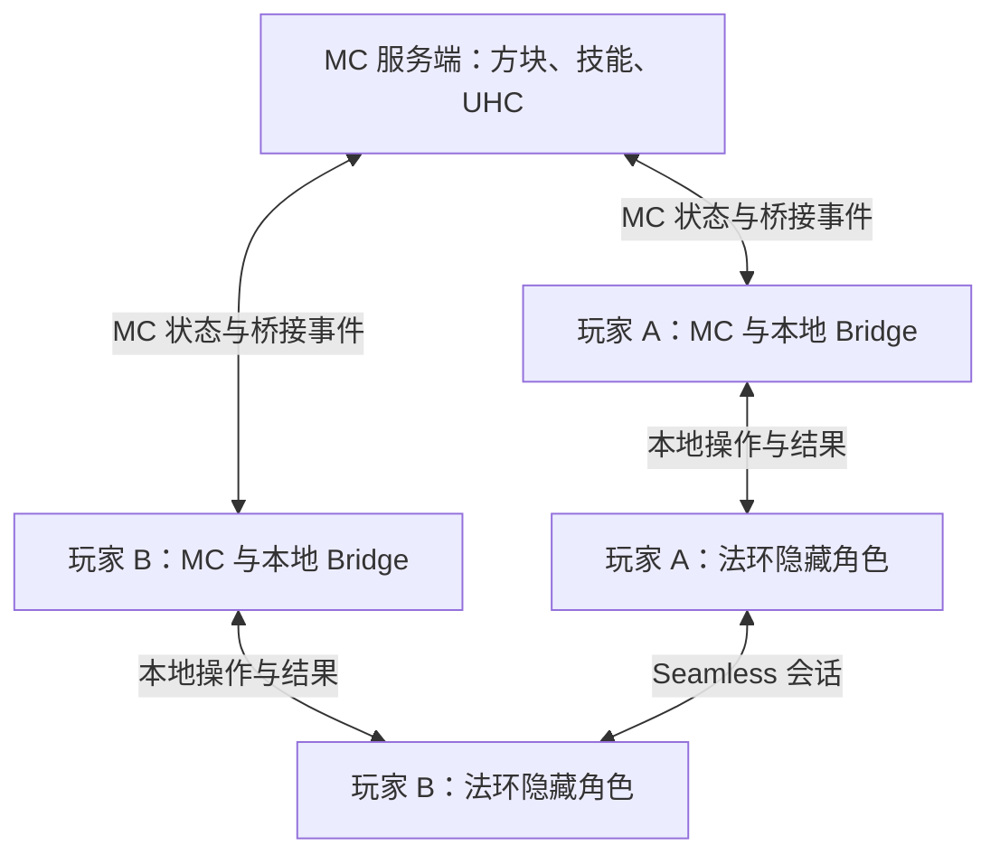

# 2026-10-13：MC 坐骑、隐藏角色施法、版本与双游戏联机

代码基线仍为 `dev/lb-poc` / `e2188391b5ba1257a9853920244909decf3bd97f`。本篇修正[前一篇](20261013-actions-growth-world-debug.md)把用户的骑马需求解释为“原生托雷特操作”的偏差，并研究小游戏、反作弊与联机。用户确认：骑乘实际走 MC；法术可由隐藏的法环角色代放。以下是源码确认与设计判断，未修改游戏实现、运行双人实验或迁移版本。

## 1. 确认的产品分工

| 系统 | 负责什么 | 不需要因此接管什么 |
| --- | --- | --- |
| MC 玩家与坐骑 | 吹哨、召唤真实 MC 马、上下马、移动/跳跃、坐骑生命与成长 | 不要求生成原生托雷特或切回原生骑乘控制 |
| 隐藏的法环角色 | 跟随玩家的位置/朝向，持有真实装备与施法条件，执行法术、祷告、战技及其原生命中 | 不成为另一名独立玩家，不重复计算同一次普通攻击 |
| MC 玩法服务端 | 技能授权、资源、对局阶段、边界、胜负与玩家最终淘汰状态 | 不依赖 UI 是否显示或哪个窗口有焦点来决定结果 |

当前 `bridge-base/elden-ring/er-bridge/src/game.cpp::stand_in` 已经隐藏原生玩家的模型并让其跟随 MC；`ERMC_CTRL_HIDE_HUNTER` 控制渲染标志。因此可以优先复用现有原生玩家，不必另造一个跟随 NPC。隐藏模型不应停止其动画、法术生成、装备判定或伤害来源身份；局部隐藏是否影响所需特效必须实测。

MC 马也要接入已有原生地形接触，记录坐骑与骑手的不同高度/身体形状，并把隐藏施法者放到合理的骑乘位置。MC 管移动不代表马可以跳过地形与怪物接触测试。

### 施法前后摇如何处理

建议最小动作状态为：`空闲 → 前摇/蓄力 → 生效 → 后摇 → 空闲`，另有打断、失败、死亡和失联分支。MC 发出请求后，由原生侧确认真正开始及结果；不要仅凭按键已发送或固定毫秒数宣布施法成功。

每类动作有自己的移动策略：允许移动、减速、锁定或应用经过验证的动作位移。普通原地法术可以保持 MC 主导位置，原生角色负责姿态与出手；带冲刺/腾空位移的战技需要另定映射，不把“所有原生动作都切回 ER 移动”当作前提。

首个法术至少验证：

- 当前 `NoMove` 接管不会屏蔽所需的动作请求；普通位置写回不会反复中断/重启动画。
- 施法器、装备条件与 FP/精力消耗正确；请求重发只产生一次效果。
- 原生手部/施法点与 MC 视角方向一致，包括俯仰、贴墙与骑乘高度；不能因为模型透明就让子弹从错误位置或墙后发出。
- 前后摇期间 Speed、Aura、攻击/换装按能力策略互斥；被打断后不继续出手，不能通过反复切模块跳过后摇。
- 原生伤害只结算一次，MC 的表现动画不再发一份代理伤害。原生法术能打法环怪，不代表自动能打普通 MC 生物或 MC 玩家；后两者要补命中与伤害映射。

## 2. EldenCraft 源码带来的实际参考

读取固定提交 [`ba7591cdde9fb16e17552cfe53546f44d0fd856e`](https://github.com/SocketByte/EldenCraft/tree/ba7591cdde9fb16e17552cfe53546f44d0fd856e)。

| 文件/事实 | 本次核对结论 |
| --- | --- |
| `WorldTorrent.java::summon` | 创建真实 MC `Horse`，带鞍、召唤效果、生命及消耗规则，符合“吹哨出来 MC 马”的外观/实体方向 |
| `WorldTorrent.java::ride` 与 `native/src/torrent.rs` | 马关闭 AI/重力/物理，跟随宿主位置；原生移动模型负责步态与碰撞。它不是完全使用原版 MC 马的自主运动，因此按用户方案复用时要改控制归属 |
| 原生菜单与交互控制 | 有可参考的原生动作/交互衔接；未确认覆盖全部法术、祷告与战技的通用施法代理接口 |
| README 与 `native/src/combat.rs` / `movement_driver.rs` | 当前设计是单人，原生会话检查拒绝多人；README 也明确 MC LAN/服务器会关闭桥接。迁移其代码不等于获得 Seamless 或 MC 多人支持 |
| 原生方块刚体与导航 | 有新增 Havok 碰撞，作者仍明确原生敌人不会绕 MC 墙寻路；二者是独立能力 |

其 PROTOCOL.md 的坐骑新鲜度文字为 150 ms，native/README.md 与 `torrent.rs::FRESH_MS` 为 350 ms，所读文档之间存在差异。复用时以固定源码与实测为准，不直接照搬说明中的时序值。本项目本轮不选定相同超时。

导航难点是原生寻路数据不知道玩家新建的墙，即使物理上挡住，AI 仍可能朝旧路线持续走。先用一堵墙区分“未碰撞”“被挡住但不绕路”“攻击能否破坏障碍”，再评估局部绕障或让特定敌人按规则破坏弱方块；这两者也是待实现方案，不代表必须先重建全图动态导航才能继续资源和技能玩法。

## 3. 当前是否迁移到 26.3

**当前继续在 1.21.1 完成最小能力与双人可行性验证，保留 26.3 独立迁移实验。** MC 马、隐藏角色施法、技能等级、UHC 计时和服务端校验都没有已发现的 26.3 专属前提。法环导航与双游戏身份/伤害同步也不会被 MC 升级自动解决。

升级有实际收益：最新 LB 已转向 26.3，新的 add-on/HUD/界面扩展值得评估；与 EldenCraft 同版本时，其 MC 侧代码更容易对照和移植。但这依然涉及本项目 Mixin、实体、网络、渲染抓取和依赖适配，且 EldenCraft 的原生架构也不同。

[Fabric 26.3 官方迁移说明](https://www.fabricmc.net/2026/09/15/263.html)列出了渲染、注册表、物品组件与世界生成等变更；[LB 2026-10-06 公告](https://liquidbounce.net/blog/article/durrkfoz)说明新版 add-ons 和 ScriptAPI 分离。它们是迁移成本/收益，不是旧版立即不可用的证据。

| 选择 | 当前建议 |
| --- | --- |
| 保留 1.21.1 | 复用已验证的 Core/LB，先证实一匹 MC 马、一个真实法术、一个双人共享敌人 |
| 移植本项目到 26.3 | 当选定必需扩展，或准备大量复用 EldenCraft 时，以独立分支验证合成、移动、实体、技能与配套服务端后再切主线 |
| 整体改用 EldenCraft | 属于换底座，需要重新适配 LB、控制权、协议和多人；当前没有证明比局部移植更省成本 |
| 回到 1.8 | 不作为这轮候选；现有 Bridge 和现代模组接口要重做，不能只为旧小游戏插件决定版本 |

不能把“客户端能连接某版本服务器”当成“该版本可加载这套模组”。也不要以“最新版反作弊支持 26.3”推定其 Fabric 服务端 JAR 必然支持 26.3，具体例子见下一节。

## 4. 小游戏插件与反作弊

小游戏规则当然可以放在 MC，但要区分 Fabric 服务端模组与 Paper/Bukkit 插件。当前 Bridge 的代理实体、地形、伤害逻辑涉及服务端行为，不是把 Fabric 客户端连到 Paper 就能完整保留。

| 服务端路线 | 能复用的生态 | 本项目需要付出的工作 |
| --- | --- | --- |
| Fabric 服务端 + 玩法模组/数据包 | Fabric 模组、原版命令/数据包、自己的 UHC 规则与 Java 逻辑 | 当前优先；从单人服务端逻辑中拆出宿主读取，用客户端 Bridge 发有身份的网络请求/事件 |
| Fabric + Cardboard | 部分 Bukkit/Spigot/Paper 插件 | 单个插件逐项验证，不保证完整 API、事件和其他模组兼容 |
| Paper + 对应 Bridge 服务端插件 | Paper 小游戏、管理与反作弊插件 | 要移植或重新表达代理实体/碰撞/伤害/协议；不承诺原 Fabric 服务端代码直接工作 |

[Fabric 官方 FAQ](https://wiki.fabricmc.net/faq:user#interoperability)明确不直接兼容 Bukkit/Paper，Cardboard 也不覆盖全部 API。[Cardboard 当前维护表](https://cardboardpowered.org/cardboard/)将 26.3 标为 TBD、1.21.1 标为低维护。升级到 26.3 不会自动得到更方便的传统小游戏插件兼容。

可以复用已有 UHC 项目的阶段、队伍、计分和配置逻辑，再把 ER 事件适配成规则层事件。换成同一名称的 API 还不够：原生敌人死亡、玩家出局、战利品和重开地图必须真正进入规则流程。大厅可以另外运行在 Paper，但大厅的插件不会因此出现在 Fabric 对局进程内。

### 反作弊要认识合法技能

[GrimAC](https://github.com/GrimAnticheat/Grim)存在 Fabric/Bukkit 两类实现和开发接口。本次读取 `f5bbe9cf55a631f40b3d28d722d0f82b514e3403`：README 总体称支持 1.8–26.3，但 `fabric/src/main/resources/fabric.mod.json` 的范围仍为 `>=1.16.1 <26` 或 `>=26.1.2 <26.3`；因此不能仅凭 README 宣称该 Fabric 制品已支持 26.3。本轮未构建/安装发布包。其 `Reach.java` 会读取交互距离属性，但这不等于已支持我们的全部能力。

对我们的游戏，Speed、Aura、骑马和原生战技都是可能被授权的行为。反作弊应检查“超过当前等级/状态允许的行为”：未解锁却施放、越过授权距离/速度、没有材料/FP 却释放、重复操作、伪造死亡/奖励、绕过施法后摇等。

普通加速/距离尽量通过服务端属性表达，让双方与校验器看见同一规则。特殊位移、原生动作和原生地形接触另接校验：现成反作弊按原版运动及方块预测，未必知道 MC 中未表达的 ER 斜坡/碰撞与身体形状，会有误判风险。不能全局豁免所有玩家后称为已完成反作弊，也不能默认配置直接处罚合法技能。

MC 反作弊还不能验证另一进程中全部 ER 状态。第一阶段按熟人合作实验；公开 PvP 前再评估可信宿主、请求裁决、事件来源和可作弊边界，不能把“装了插件”写成公平竞技已解决。

## 5. 联机：同一 MC 服务器与同一 ER 会话协同

用户提出的组合方向合理：每位玩家运行 MC + 本地 Bridge + ER，MC 加入同一服务端，法环加入同一 Seamless 会话。**这是候选架构，现有两项目都未证明可直接这样运行。**

MC 服务端可独立部署；ER 会话仍需要真实游戏进程作宿主，不能假设在现有 Linux MC 服务端上多装一个插件就得到无头法环服务器。Steam 身份与 MC UUID 通过当前对局配对，不能按显示名字猜归属。

| 状态 | 建议权威与同步要求 |
| --- | --- |
| MC 地图、方块、马、库存、技能、对局时钟 | MC 服务端；每位玩家使用一致的地图/坐标变换、版本和区块修订 |
| 原生敌人 AI、动画、原生攻击、世界事件 | ER 联机会话的有效网络权威节点；先验证普通敌人，再验证 Boss/脚本 |
| 玩家生命、治疗、出局与胜负 | MC 对局规则决定最终状态；原生受击作为对应玩家的伤害事件进入，避免两边各自复活 |
| MC 攻击原生怪物、原生法术命中玩家 | 跨域请求/结果必须有玩家、目标、场景、动作和去重身份；由有效权威执行一次 |
| 玩家放置的物理墙 | MC 服务端确认方块，每个有需要的 ER 物理世界按同一版本建立/移除碰撞体；不假设 Seamless 自动同步自定义 Havok 对象 |

两套联机同时开仍缺以下桥接：

1. **身份和共同坐标。** 当前 `CoordMap` 可按本地首次采样锚定，联机要服务器发布固定变换。原生裸指针和本地 MC entity ID 都不能作为跨机共同身份。
2. **宿主读取拆分。** MC 云端服务端无法读取玩家电脑的共享内存。当前 `CombatBridge` / `LifeBridge` 对服务端玩家列表广播单宿主事件，必须按玩家配对与事件来源重做，不能直接开 LAN。
3. **同一个敌人只受一次伤。** 每人都观察到敌人不代表每人各扣一次血；本机直接内存改血是否经 Seamless 正确复制要实验。掉落和死亡同样只结算一次；卸载/掉线不算击杀。
4. **远端角色不重复显示或受击。** MC 玩家和对应 ER 隐藏角色代表同一玩家；远端隐藏、目标选择、受击位置和队伍关系要一致。原生法术 PvP 还需要单独的命中转发，不能只凭看见特效判定命中。
5. **断线和回滚。** MC 在线但 ER 断线、换图或会话改变时，应暂停该玩家的桥接战斗/结算；重新加入需核对场景、敌人和方块修订，不能重放过期伤害。

### Seamless 不是已经验证的通用后端

[作者说明](https://www.nexusmods.com/eldenring/mods/510)确认其基于 Steam 的联机、共享世界事件，并有自己的复活/赐福重置规则；同时明确不保证其他模组兼容，并会禁用部分调试标志和运行时参数修改。这与本项目的接管/位置写回存在实际兼容性风险，不能按“关闭 EAC 就能共载”推断。

截至本次查询，[官方发布页](https://github.com/yuiamoroll/EldenRingSeamlessCoopRelease/releases)最新为 v2.0.1，发布文字注明适配 1.17；没有据此确认本项目的 1.17.1 + Bridge 组合通过。第一步应验证目标游戏版本、两人普通连接、隐藏跟随与一次攻击，再决定是否投入双网络集成。

## 6. UHC 如何在这套架构上成立

UHC 的固定赛区、资源与制作、队伍、自然回血策略、PvP 开启时间、缩圈、淘汰/观战、掉落和胜负都适合由 MC 服务端统一执行。边界视觉走现有 MC 合成进入最终画面；惩罚按服务端的对应坐标判断。MC 画出了圈不等于原生世界里生成了物理墙，视觉与规则分别验收。

需要特别接管原生休息回血、圣杯瓶、死亡复活、Seamless 赐福全局重置、Boss 状态和原生奖励；它们若照常运行，会绕过 UHC 的生命/资源/淘汰规则。可以选择保留为有成本的技能或补给，但由对局配置明确授权，不能只设置 `naturalRegeneration=false` 就称 UHC 完成。

先验收两人共同打一只普通法环怪、每人受击不串、一次死亡/奖励与一个 MC 方块同步；再做短局 PvE。PvP 和原生法术 PvP 在队伍、伤害去重和延迟行为可解释后加入。目标可以扩展多人 UHC，但不根据 MC 服务器能容纳的人数承诺法环会话相同的规模。

## 7. 紧接着做什么

1. 保留前篇 R12 身体接触与 R03 调试实例归属修复；产品范围改为 MC 坐骑，不再把完整原生托雷特操作列为前置。
2. 同一小区域完成 MC 吹哨召马、上下马，以及隐藏原生玩家释放一个普通法术；明确前后摇和坐骑高度。这两项在 1.21.1 做即可。
3. 单独做两人 Seamless + 当前 Bridge 可行性实验。只要核心接管不兼容，就记录具体失败边界并重新选择联机后端，不先开发完整匹配/反作弊平台。
4. 兼容成立后实现共享坐标、玩家绑定、伤害路由和一次结算，再组合短局 UHC 规则。26.3 只在明确依赖/复用收益和迁移验收通过后切换。

本篇没有创建新仓库、安装插件/反作弊、部署服务器或声称功能通过。先修正需求与架构，再用最小场景检验，不增加当前 LB 计划的虚假通过项。
